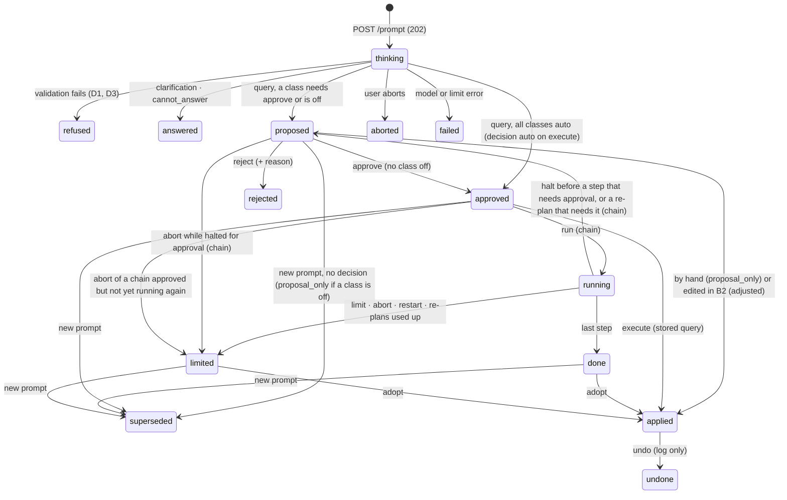
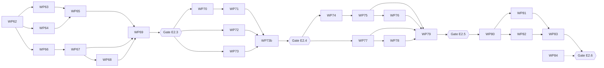

# Plan E2.3–E2.6 — Prompt, enforcement, tool chain, dialogue

> Stand: 2026-10-10 · **bereit zur Umsetzung · Entscheidungen D1–D10 und P1–P6 getroffen, WPs geschnitten (WP62–WP84), Design liegt vor** · Bezug: [anforderungen.md](../anforderungen.md) (F-3.9, F-5.1, F-5.4–F-5.18, F-6.1–F-6.9, F-9.5, F-9.6), [etappen.md 4](../etappen.md), [plan-e2.0-e2.2.md](plan-e2.0-e2.2.md), Design: [design/e2/README.md](../design/e2/README.md) (Bildschirme M1–M16, `fixture/modus-b.json`, `screenshots/`)
>
> Integration branch **`ep-2.3-6`**: each WP is its own branch from it (`wpNN-…`), merged back with `--no-ff` after its gate and review; `ep-2.3-6` merges into `main` once every WP of this plan is done and the E2.6 gate is green. Continues with WP62 (merged 2026-10-10). Each WP is one branch and one commit series, passes the **WP gate** (section 5) and a **code review** before it merges. Each etappe ends with an **etappe gate** that includes `make gate`, an acceptance test and a review of the integrated diff.

## 1 Decisions (2026-10-09)

| # | Question | Decision | Why |
|---|---|---|---|
| D1 | Meaning of `off` | Not executable by the model, but visible as a proposal the user can apply by hand. Refused only: invalid schema, unknown or invisible layer, limit exceeded, not representable (D3). **Amends plan-e2.0-e2.2 H4** (no `class_not_allowed` refusal) | Makes H5 (explain-only level) and F-5.16 consistent |
| D2 | Enforcement | The **action record** is the proposal and the log (F-6.8). `POST /api/model/prompt` stores it and returns explanation and query **without result data**. Status `auto` (all classes `auto`) runs at once; otherwise `proposed`. `approve` is refused if any class is `off`. `execute` runs the **stored** query, never a client-sent one, and only for `approved`/`auto` (409 otherwise). "Adjust" leaves the model path: the edited query runs through the Modus A endpoints, logged as `adjusted` with the base action id. Undo is reported for the log only | The guarantee is "the model path never executes more than the level allows", not control of the user's own state (Modus A stays open). One table serves F-6.7, F-6.8 and E4.2 |
| D3 | Representability | The model is limited to query objects the controls can show without loss. A new pure function `to_analysis(query)` (inverse of `analysis/query.ts`) decides; failure ⇒ `not_representable`. Round-trip test: analysis → query → analysis is identical | F-5.16 needs the reverse direction, which does not exist yet |
| D4 | Log visibility | Users see their own entries, administrators all, including prompt text. The prompt panel says inputs are logged. E3.4 can read the log | F-6.9, E3.4 |
| D5 | Ambiguity (F-5.13) | Assumptions are stated in the answer (F-5.12). A clarification question only when no sensible assumption exists; never several full interpretations | Fewest round trips |
| D6 | Wrong approach (F-5.14) | The answer carries a button for the other approach; it switches the toggle and fills the same prompt, sending only on click | No automatic switch (F-5.4) |
| D7 | Model result | One structured result: `query` · `clarification` · `cannot_answer`. Output format is part of the app-generated prompt, not editable system-prompt text | Covers F-5.13/5.14 without extra calls |
| D8 | Dialogue | Held in the open workplace only, not in the saved session. Follow-up context: system prompt, profile, current analysis as query object, last 6 turns. Over budget ⇒ `context_too_large` | The log is the durable record |
| D9 | What the model sees of a step result (E2.5) | Per step: `ok`/`error` (code and validation text derived from the query only, never echoing row values), `empty`/`not empty`, and the **hit count**, with or without data release. Never rows, geometries, extents or attribute values. No value-inspection tool in E2.5. **Amends the reading of F-9.3 / S1:** a hit count of a model-built query counts as result metadata, not as a data content | Lets the chain correct itself and keeps the comparison with the direct query meaningful |
| D10 | Consequence for the data-release flag | In E2.5 the flag has **no effect on what the model sees**, because nothing it could release is offered. It stays stored and shown (E2.1). It starts to bite with the first tool that returns row content (value inspection, samples). One function `model_view(result)` is the only way an engine result reaches the model; a sentinel test (like S7) proves that no row content passes it | The flag must not suggest protection that the code does not give. The enforcement point exists now, so the later tool cannot bypass it |

Accepted residual risk (D9): repeated counts with changed filters reveal how attribute values are distributed. Bounded by 8 steps per request and the action log; not countered otherwise.

Limits (F-3.9, F-9.6), values from `fixture/modus-b.json` `grenzen`: at most 8 conditions per query object, 8 model steps per request (re-planned steps included), existing 10 000 objects and 10 s per query, 120 s per model call, 300 s per chain request (P4). Undo: exactly the last model change. The daily quota (`kontingent_tag`, 50, M14.4) is a connection-level limit; see P5.

### 1.1 Additional decisions from the design review (2026-10-10)

The design (`design/e2/README.md`, 18 review decisions) fixes the surface. Where it needs a backend rule, the rule is set here. P1–P6 are decided (2026-10-10).

| # | Question | Decision | Why |
|---|---|---|---|
| P1 | E2.3 before E2.4 (**decided 2026-10-10**) | In E2.3 **every level behaves as proposal-only**: the answer shows the query, the user applies it by hand ("In Editor übernehmen", M4 pattern), the decision is `proposal_only`. Approve/execute/auto/undo arrive with E2.4 and replace this behaviour behind the same record and endpoints. **E2.3 is an internal milestone and is not released to users before E2.4 is done**; records written during E2.3 are development data and need no migration or exclusion from the key figures. If that ever changes, WP63 adds a flag the key-figure query uses to ignore them | No model-path execution exists before the level rules do, so the guarantee of D2 holds trivially. The M4 screen is permanent (*Assistenz* level), so little is throwaway. E2.4 adds transitions only, not a new record or endpoint |
| P2 | Preview count (M5.1 "39 → 7") (**decided 2026-10-10**) | `POST /api/model/actions/{id}/preview` (a `GET` until the E2.4 gate, section 6) runs the **stored** query as the caller (visibility and limits as Modus A) and returns count, total and object ids for the dashed map layer. Rules: (1) it needs an **interactive user session** and is refused for any model or MCP token, so F-6.7 holds for E4; (2) offered **only when no class is `off`** (design M4.1: no preview there); (3) it changes no status, and the model never sees its result (design Q5); (4) `previewed_at` is set on the record so the log shows that a preview ran; (5) `execute` always re-runs the stored query and never reuses the preview result; (6) arrives with E2.4 (WP70), E2.3 has no preview (P1). **Reading of F-6.2:** "Freigabedialog vor der Ausführung" means before the analysis changes; the preview is a read-only run by the user's own session, not an execution on the model path | The user may run the same query by hand anyway; the guarantee in D2 concerns the model path. The preview uses the same stored query that `execute` will run, so what the user sees is what is approved |
| P3 | Origin mark "Modell" (**decided 2026-10-10**) | Frontend-only, per condition, session-local, never saved, no link to saved queries (design). Backend returns the query only; the frontend stamps the conditions of an applied model query and clears the stamp on any hand edit of field, operator or value | Matches the design; no schema change |
| P4 | Chain run (**decided 2026-10-10**) | Planning is **one model call** that returns the full step list (`plan`, F-6.5). The app runs the steps one at a time as an in-process background task (the server is a single uvicorn process); engine queries run in a thread so the event loop is not blocked. The client polls `GET /api/model/actions/{id}` about once a second, steps and `model_view` persist as they finish; no streaming. **Re-plan:** after a step that errors, or returns empty at an intermediate step, the model gets one re-plan call with `model_view` of all steps so far, at most 2 per request. An empty **final** step is not re-planned: 0 hits is shown as the result. A re-plan revises only the remaining steps; completed steps are fixed; the 8-step limit counts completed plus revised steps (`step_limit`). A re-plan that changes steps returns the action to `wartet auf Freigabe` where the level demands it (*Prüfen*: always; *Teilautonom*: only for revised steps whose cell is `approve`; *Automatisch*: never). **Time:** 120 s per model call and 10 s per step as before, plus a hard cap of **300 s per request** (`time_limit`, same "angehalten · Begrenzung" state as M9.5). Abort stops before the next step. A `running` record found at start-up is closed as `limited`/`interrupted` (P7); its last complete intermediate result stays adoptable | Matches M8/M9 (plan visible before the run, "Modell sieht" per step), the fixture timings (planning 9 s, run 3.6 s, so no model call between steps) and D9 (the chain can correct itself), without a token stream. The cap bounds the worst case, which would otherwise be about 7 minutes |
| P5 | Quota (M14.4) (**decided 2026-10-10**) | An **administrator decision per connection**: switch `request_limit_enabled` (default off) and threshold `request_limit_per_day` (positive integer, required while the switch is on; the fixture's 50 is only an example). Counted per connection over all accounts (no per-account limit) from the action table: every request that reached the model call, per calendar day of the server's time zone; refusals before the call (`context_too_large`, `stale_reference`, …) do not count. Exceeded ⇒ `quota_exceeded` before any model call, message names the limit and that an administrator sets it. Off ⇒ no counting check at all. Provider-side 429 is shown as the same message. Admin edits both on the connection form (extends the E2.1 form); change is audited with `llm_connection_changed` (C16) | The design shows the case; the admin, not the code, decides whether and how tightly an external or costly model is capped. The action table already holds what is needed |
| P6 | Follow-up reference (M11) (**decided 2026-10-10**) | The dialogue is a **thread of action records**. Each record stores `parent_action_id` (the answer the prompt follows; null for a fresh question). The client sends only `parent_action_id` and `analysis` (the current analysis as query object); it sends **no turns**. The server loads the parent chain, at most 6 records back, own records only (404 otherwise), and builds the turns from them: prompt, explanation, assumptions, decision and the reason chip of a rejected answer; the turn's own query is not repeated, the current analysis covers the state. The reference kind is **derived by the server**: `last_answer` if the canonical form of `analysis` equals the parent's query, else `hand_edited` (the model is told the user changed the state by hand since its last answer, M11.2); stored on the record with `parent_action_id`. × in M11.1 ("ohne Bezug") sends no parent and no analysis: a fresh question. The oldest turns beyond 6 leave the model context, not the screen. Over the context budget ⇒ `context_too_large`, never a silent cut. A parent whose layers no longer exist or are invisible ⇒ `stale_reference` before any model call (M11.3). An analysis over the condition limit ⇒ `limit_exceeded` with counts (as M3.2). **Not restored after a reload** (D8 stays: the analysis the dialogue refers to is client state and is gone too); the stored thread links allow a restore later without a migration | The log already holds prompt, answer and decision durably (D4), so the server builds authentic turns from its own records: nothing forged to validate, a small payload, and the log shows the thread (M16.2) |
| P7 | Request flow (**decided in WP62 review, 2026-10-10**) | `POST /api/model/prompt` answers **202 at once** with the record in status `thinking`; the model call runs as a background task and the client polls `GET /api/model/actions/{id}` (about once a second, as for chains in P4) until the status changes. So `abort` has an id to address while the model thinks (M2.1), and a closed window leaves a record the start-up check can close. An answer whose cell is `auto` arrives `approved` without a question; the client calls `execute` at once and the decision becomes `auto` (D2: still only the stored query runs). Rows leave **only** in `ExecuteResponse {action, result}` from `execute` and `adopt`; no view of a record carries them (D10). A chain stopped by a limit, an abort or a restart ends `limited` with `stop_reason`, its last complete result adoptable, and gets its decision on adopt or supersede. Comparison: `POST .../compare` starts the other approach as a new record with `compare_of` (202), `POST .../comparison` (a `GET` until the E2.5 gate, review #41) returns the difference | Found in the WP62 review: a synchronous prompt left nothing to abort, and rows in the polled record would have been one step from the model's next turn |

### 1.2 Model result and record (shared contract)

The status names are those of `ActionStatus` in `geotandem/model/schemas.py`. Terminal **decisions** (section 2) are stored in `model_action.decision`; transient state is `model_action.status`. The record keeps, as they were when asked (H7): level id, name, matrix and prompt hash; connection id, host and external flag; profile hash (S4); prompt text and its hash; approach; parent action id and the derived reference kind (P6); assumptions; query JSON and its `classify` result; for chains the steps with class, result stamp, `model_view`, duration; decision with time and optional reason; `applied_by_hand`; `undone`.

## 2 Measuring acceptance

Every action ends with exactly one **decision**, stored on the action record:

| Decision | Meaning |
|---|---|
| `accepted` | approved unchanged |
| `adjusted` | edited in the editor, then applied |
| `rejected` | declined; optional reason chip (misunderstood · wrong layer · wrong value · other) |
| `superseded` | a new prompt was sent without deciding |
| `auto` | applied without a question; `undone` is set if reverted |
| `proposal_only` | level had `off` parts; user applied by hand or not (`applied_by_hand` flag), also when the next prompt overtakes it — never counted as `superseded` |
| `aborted` / `failed` | cancelled by the user / model or limit error |

Key figures, on the log page, by period and broken down by level, connection and approach: proposals total; share `accepted`, `adjusted`, `rejected`, `superseded`; of `auto`, share `undone`. **Acceptance rate = (accepted + adjusted) / (accepted + adjusted + rejected + superseded)**; `auto` is reported separately because nobody decided. `aborted`/`failed` are excluded and counted on their own. Computed by a query over the action table; no extra store. The same decisions feed E3.17-style key figures later.

Refusals (D1, D3, M3) are not decisions: they are records with status `refused`, a `refusal` (`{code, message, details}`), and the rejected query kept for inspection. They appear in the log and in the key figures as "not counted" (`abgewiesen`), like the fixture's `kennzahlen_30_tage.nicht_gezaehlt`.

## 3 Workstreams and file ownership

Parallel work only stays parallel when WPs do not edit the same files. Each WP owns the paths below; a path outside a WP's ownership is changed only in the **contract freeze (WP62)** or by the integrator at merge.

| Stream | Owns | WPs |
|---|---|---|
| **BE-record** | `backend/src/geotandem/model/record/`, migration `0009_model_actions.py`, `api/model_log.py` | WP63, WP73 |
| **BE-direct** | `backend/src/geotandem/model/{prompt,result,validate,represent}.py`, `packages/query` (`to_analysis` reference cases only) | WP64 |
| **BE-flow** | `backend/src/geotandem/model/service.py`, `api/model.py` | WP65, WP71 |
| **BE-chain** | `backend/src/geotandem/model/chain/`, `tools/` (chain wrappers, `model_view`), `api/model_chain.py` | WP75, WP76 |
| **FE-core** | `frontend/src/model/{store,status,tree,origin}.ts(x)` | WP66 |
| **FE-panel** | `frontend/src/model/panel/` | WP67, WP68 |
| **FE-approval** | `frontend/src/model/approval/` | WP70, WP72 |
| **FE-chain** | `frontend/src/model/chain/` | WP77, WP78 |
| **FE-dialog** | `frontend/src/model/dialog/`, `frontend/src/analysis/query.ts` (`toAnalysis`) | WP80, WP81 |
| **FE-log** | `frontend/src/admin/ModelLogPage.tsx`, `frontend/src/model/log/` | WP74 |
| **Contract** | `backend/src/geotandem/model/schemas.py`, `schema/model-cases/`, `frontend/src/test/model-mocks.ts` | WP62; later changes only by the integrator, with `make gen` |
| **E2E** | `e2e/tests/acceptance-e2.{3,4,5,6}.spec.ts`, `e2e/model-stub/` | WP69, WP73b, WP79, WP83 |

Shared, single-writer files and their rule:

- `frontend/src/locales/de.po` (and `pseudo.po`): written only by `npm run i18n:extract`, which sorts the whole file (so the earlier "one block per WP" rule cannot hold; changed in the WP66 review). A merge conflict here is resolved by taking either side and re-running the extraction after the merge; `npm run i18n:check` is part of every WP gate.
- `frontend/src/api/schema.d.ts`, `frontend/openapi.json`, `frontend/error-codes.json`, `schema/`: generated only (`make gen`). A conflict is resolved by re-running `make gen` after the merge, never by hand.
- `backend/src/geotandem/api/routes.py`, `errors.py`: WP62 registers all routers and all error codes up front (stubs answering 501), so later WPs only fill in bodies.
- Migrations: **0009** for E2.3 (WP63; frozen with the tag `e2.3`), **0010** for E2.4 (WP70: `touched_at`, added in the WP70 review because 0009 was already tagged), **0011** for E2.5 (WP75: step table), **0012** for the E2.5 gate (security review #43: `model_call`, a chain's re-plans counted for the request limit). No other WP creates a migration; a WP that needs one waits for the integrator to assign the number.

## 4 Work packages

Legend — **Deps**: WPs that must be merged first. **Parallel with**: safe to run at the same time in its own worktree. **Done when**: the WP's acceptance, beyond the standard WP gate.

### Etappe E2.3 — Direct query

#### WP62 — Contract freeze (serial, small, first)
*Deps: none · Parallel with: none (everything forks from it)*

- Docs: [CONTEXT.md](../CONTEXT.md) — *Modellaktion* (action record), *Entscheidung*, *Vorschlag*, *Herkunftsmarke*, *Datenfreigabe* (hit counts of model-built queries are not a content, D9). [anforderungen.md](../anforderungen.md) F-5.x/F-6.x marked with the decisions D1–D10, P1–P6; F-6.2 annotated: "vor der Ausführung" = before the analysis changes, a read-only preview by the user's own session is allowed (P2). [etappen.md](../etappen.md) E2.3–E2.6 marked decided. Plan e2.0–e2.2 H4 annotated "amended by D1".
- Contract in code (**done**): `geotandem/model/schemas.py` — the model's answer `ModelAnswer` (`query` · `clarification` · `cannot_answer` · `plan`, D7; the query inside stays raw JSON so a refused one can be shown), `PromptRequest` (text, approach, `parent_action_id`, `analysis`; extra fields forbidden, so no turns, P6), `DecideRequest`, `RejectRequest`, `PlanEdit`, `ModelActionView` (with `LevelSnapshot`, `ConnectionSnapshot`, `Governance`, `Refusal`, `StepView`, `ModelView`), `ModelActionSummary`/`ModelActionPage`, `ActionPreview`, `Comparison`, `KeyFigures`, the limits (`MAX_CONDITIONS` 8, `MAX_STEPS` 8, `MAX_REPLANS` 2, `CHAIN_TIME_LIMIT_S` 300, `MAX_TURNS` 6) and the code literals `RefusalCode`, `ActionErrorCode`. Routers `api/model.py` (`/api/model/*`) and `api/model_log.py` (`/api/admin/model-actions*`, admin only); every route answers 501 `not_implemented` naming its WP.
- Error codes (**done**, reusing what exists): refusals use the engine's codes where they fit (`unknown_layer`, which also covers a layer hidden from the account so a prompt cannot probe for hidden layers, `unknown_attribute`, `query_too_complex`, `wrong_value_type`, `invalid_query`) plus `model_query_invalid`, `limit_exceeded`, `not_representable`, `step_limit`. Route errors: `class_not_allowed` (existing, for `approve` with an `off` class), `not_approved`, `already_decided`, `nothing_to_undo`, `undo_blocked`, `context_too_large`, `stale_reference`, `model_unreadable`, `quota_exceeded`, `time_limit`, the temporary `not_implemented`; transport failures keep the `llm_*` codes of E2.1 (`llm_unreachable`, `llm_timeout`, `llm_rate_limited`, …) and `result_too_large` stays the engine's. German words in `frontend/src/i18n/errors.ts`. Dropped from the draft list: `layer_not_visible`, `layer_unknown`, `schema_invalid`, `class_off`, `superseded`, `model_unreachable`, `model_timeout`.
- Contract fixture (**done**): `schema/model-cases/v1.json`, the design's cases (M3, M11–M14, M8) on the **real sample data**: the reference answer is the E1 reference question (`e2e/fixtures/reference-question.json`, 10 of 137 schools), not the design's illustrative 7 of 39. Levels, connections, limits and the key figures of the design are in it too. The chain case is provisional until WP74 names the chain tools. The Dockerfile copies all of `schema/` for the frontend type check.
- Backend: `backend/tests/model_fixtures.py` (`case`, `completion`, `scripted(*ids) -> FakeLLMClient`) and `test_model_contract.py` (every answer fits the schema, refusals are genuine, codes are registered, every route exists, needs a session, answers 501; the log is admin-only; no OpenAPI schema name clash).
- Frontend: types exported in `api/client.ts`; `frontend/src/test/model-mocks.ts` builds `ModelActionView`s and `fakeApi` routes from the same fixture (the existing `fakeApi` instead of a new `msw` dependency) with its own test. No i18n key skeleton: `lingui extract --clean` keeps only messages used in code, so messages arrive with the components.
- **Done when:** `make gen` is clean, every stub route is in the OpenAPI, the contract test asserts that each fixture case validates against the schemas, WP gate green.

#### WP63 — Action record and key figures (BE-record)
*Deps: WP62 · Parallel with: WP64, WP66, WP67 (against mocks)*

- Migration `0009_model_actions.py`: `model_action` (with `previewed_at`, P2, and `parent_action_id` plus the derived reference kind, P6), `llm_connection.request_limit_enabled` (bool, default false) and `llm_connection.request_limit_per_day` (int, nullable; check constraint: not null and > 0 when enabled) (P5). Plain SQLAlchemy, runs on both backends (P track). Indexes on `(user_id, created_at)` and `(decision, created_at)`.
- Repository `ModelActionStore`: create, transition (state machine of 1.2, illegal transition ⇒ `already_decided`/`not_approved`), set decision once, list with filters (period, level, connection, approach, user), key-figure query (section 2) as one SQL aggregation.
- Snapshot of level and connection as they were (H7) — a test edits the level afterwards and asserts the record is unchanged.
- Audit events: `model_action_decided`, `model_action_undone`. Logs carry ids and codes only (C15), never prompt text.
- Visibility (D4): store methods take the caller; users see own rows only, admins all. Tested per method.
- **Done when:** property test over random transition sequences never reaches an illegal state; key figures reproduce `kennzahlen_30_tage` from the fixture rows exactly; migration up/down on SQLite and PostgreSQL-compatible test engine.

#### WP64 — Direct query core (BE-direct)
*Deps: WP62 (types only; uses a fake store) · Parallel with: WP63, WP66, WP67*

- `prompt.py`: assembles messages from system prompt of the level (H9), layer profile (S4, hash recorded), the fixed output-format block (D7, not editable), context (P6: current analysis as query object, up to 6 turns built from the parent chain by the caller of the builder), user text. Size check against the connection's declared context length ⇒ `context_too_large` before the call.
- `result.py`: parses the reply as `ModelAnswer` (`query | clarification | cannot_answer`; `plan` belongs to WP75) and sends `answer_schema()` as the output format; parse failure ⇒ `model_unreadable` (verbatim cause in details, not shown to the model again).
- `validate.py`: schema validation against the E1.2 query schema; layer existence and **visibility for the account** (one code, `unknown_layer`, for both, as the engine does: a prompt must not confirm that a hidden layer exists; design M3.1 words it as "nicht vorhanden oder nicht sichtbar"); condition limit 8 and the existing complexity limit ⇒ `limit_exceeded` with counts in details; writes impossible by schema (F-9.5, tested by attempting a write-shaped object).
- `represent.py`: `to_analysis(query)` and failure ⇒ `not_representable` (D3). Python reference implementation used for the refusal decision; the TypeScript inverse in WP80 must agree on a shared case list (`schema/model-cases/represent.json`).
- Clarification limited to 2–4 options plus free text (M12.2); assumptions list (F-5.12).
- Single entry point `DirectQuery.run(request, account) -> ModelAnswer | Refusal`, no HTTP, no store; unit-testable with `FakeLLMClient`.
- **Done when:** every fixture dialogue with a refusal or clarification code produces exactly that code; the reference question yields the fixture query object and, run through the engine, 10 of 137; `classify` of that query is `{query, spatial}`; sentinel test: no row value appears in any prompt built (extends S7).

#### WP65 — Prompt flow, proposal-only (BE-flow)
*Deps: WP63, WP64 · Parallel with: WP67, WP68 (mocks)*

- `service.py` + `api/model.py`: `POST /api/model/prompt` — resolves level (`resolve_level`) and connection (C17) **server-side**, checks the connection's request limit when the admin switched it on (P5; boundary test at limit and limit + 1, off ⇒ never refused, day rollover with an injected clock; connection API and its validation extended here), supersedes the account's previous open `proposed` record (decision `superseded`), calls `DirectQuery`, stores the record, returns `ModelActionView` without result data. Per P1 every record is created as `proposed` (or `refused`/`answered`).
- `GET /api/model/actions/{id}` (own or admin), `POST /api/model/actions/{id}/decide` with `{decision: "proposal_only"|"adjusted", applied_by_hand?, query?}` for the hand-over cases (the only decisions possible before E2.4).
- Request flow (P7): the record is stored `thinking` and returned with 202; the model call runs as a background task; the client polls. Timeout 120 s; `POST /api/model/actions/{id}/abort` while `thinking` cancels the call, decision `aborted`, a late answer is dropped (fixture case `aborted`).
- Failure mapping to M14 codes: connection refused ⇒ `llm_unreachable`, timeout ⇒ `llm_timeout`, provider 429 ⇒ `llm_rate_limited` (shown as M14.4), unreadable answer ⇒ `model_unreadable`; the state of the analysis is never touched (nothing server-side holds it).
- **Done when:** API tests for each M3/M13/M14 code and each fixture dialogue; the prompt text never appears in the application log (C15); another account's record answers 404 (not 403).

#### WP66 — Frontend core (FE-core)
*Deps: WP62 · Parallel with: WP63, WP64*

- `model` slice beside the analysis store: panel open/closed, draft text, approach, running request, dialogue as a list of action ids with their views (flüchtig, D8, cleared on reload and not part of the saved session; the server builds the model's turns from the parent chain, P6), at most one open proposal, reference selection (parent id or none).
- `StatusLabel` and line-style tokens (design "Statussprache": dashed = proposal/plan/run, solid accent = applied, grey + struck label = undone/rejected/refused/stale/aborted, black = clarification/message/error). Only the existing Classical tokens; no new colours.
- Readable condition tree shared by M2, M5, M15: the existing tree view plus the **Herkunftsmarke** (P3), plain-language operator text, "Technisch" disclosure with JSON.
- Origin-mark logic in the analysis store: stamped on apply, cleared on hand edit of field/operator/value, never serialised into sessions or saved queries (test: session export has no mark).
- Header: connection · level ▾ (M7 entry) reuses `ModelChoice`; "Keine Modellanbindung" state.
- **Done when:** component tests for every status label in light and pseudo-locale; mark lifecycle test; accessibility checks of the status components by role, name and text (the repo has no axe dependency; adding `axe-core` is an open decision, recorded in the WP66 review); no `any` introduced.

#### WP67 — Prompt panel and answer (FE-panel)
*Deps: WP66 (+ contract mocks) · Parallel with: WP63–WP65 until integration*

- Sidebar tab Klassik | Prompt; 460 px panel between sidebar and map, map and table stay live (M1.1–M1.3, external notice with host M1.2, data-release line, disabled tab with admin link M1.3).
- Input, ⌘/Ctrl+Enter, approach toggle (chain disabled until E2.5 with "ab E2.5"), 2–3 example prompts from the visible layers (click fills, never sends), status line with "Ihre Eingaben werden protokolliert".
- Answer card (M2.1–M2.3): working state with timer to 2:00 and Abbrechen, locked input, no streaming; explanation, assumptions with ≈, readable query, status, actions *Im Editor öffnen* / *Zurücknehmen* (E2.4) / *Protokoll*.
- Refusals M3.1–M3.3 (`role="alert"`, reason in words, code under "Details", rejected query viewable, not applicable; *Prompt ändern* returns text to the field, *Erneut versuchen*); offer of the chain on `not_representable` shows only when the chain exists (E2.5).
- Proposal-only (M4.1, M4.2): *In Editor übernehmen* opens B2 with the draft; only the editor's "Übernehmen" changes the analysis, reported through `decide`.
- Errors M14.1–M14.4: what happened · "Ihr Stand ist unverändert" · action; prompt stays in the field.
- **Done when:** component tests per state against the mock API; keyboard test (focus order, Esc, Ctrl+Enter); no layout shift beyond 460 px panel at 1280 px width.

#### WP68 — Unfit approach and ambiguity answers (FE-panel)
*Deps: WP67 · Parallel with: WP65 (mock), WP69*

- M12.1 assumption with "ändern" (opens the condition in B2), M12.2 clarification with 2–4 options plus free answer (analysis untouched; answering sends a new prompt with the answer as context).
- M13.1 *Mit Werkzeugkette versuchen* (switches the toggle, fills the field, does not send — D6), M13.2 cannot-answer lists what is missing, no button.
- Admin connection form (`admin/ConnectionsPage.tsx`, owned by this WP for P5): switch "Anfragen pro Tag begrenzen" and a number field that is enabled and required only while the switch is on; validation messages from the backend codes; M14.4 text names the limit.
- **Done when:** component tests; the button never sends (asserted on the mock).

#### WP69 — E2.3 acceptance (E2E)
*Deps: WP65, WP67, WP68 · Parallel with: none*

- `e2e/model-stub/`: a small OpenAI-compatible stub server, scripted from the fixture (reference question, clarification, cannot-answer, malformed output, slow answer, 5xx). Started by `scripts/gate.sh` on the internal network next to the container; connection created through the admin UI in the test, so it is the real path.
- `acceptance-e2.3.spec.ts`: reference question → answer with assumptions → *In Editor übernehmen* → 10 of 137 equal to the hand-built result of E1 (same query object, deep-equal); a layer that does not exist or is hidden from `m.keller` ⇒ `unknown_layer` (M3.1); limit and not-representable refusals; unreachable model leaves the analysis unchanged; external connection shows host and notice; **a write-shaped answer from the stub is refused**.
- Offline proof: the model stub is the only reachable host.

#### Gate E2.3
**Passed 2026-10-10** on `ep-2.3-6` (tag `e2.3`), run in a Linux container on a Windows host through `GATE_RUNNER_CONTAINER`, Playwright with one worker:
- lint clean; backend tests all green; frontend 421/422 (the one failure is `src/i18n/locale.test.ts`, which fails the same way on main in that container); `make audit` clean;
- image, first start, both Playwright passes 45 passed and 1 skipped (E2.1 with a local model), restart;
- etappe review with findings fixed and re-reviewed (`e23-gate-fixes`).

Open from the gate list (5.2):
- the run on a Linux host (`make gate`, default workers);
- the real-model run (`GATE_LLM_MODEL`);
- the design walk against the screenshots (5.5, E2.3 states).

See section 5.2. Entry: WP62–WP69 merged. Done-when (etappen.md): one prompt produces the same query object that was built by hand in E1; no write operation passes on this path.

### Etappe E2.4 — Enforcement

#### WP70 — Enforcement service (BE-flow)
*Deps: Gate E2.3 · Parallel with: WP71 (same stream, separate files), WP72, WP73*

- Transition endpoints: `approve` (refused with `class_not_allowed` if any class of the **stored** `classify(query)` is `off` at the **snapshotted** level; stored status must be `proposed`), `reject` (+ reason chip), `execute` (stored query only, status `approved`/`auto`, else 409 `not_approved`; runs through the engine as the caller with all existing limits; returns the Modus A run response shape), `undo` (log only: sets `undone`, allowed for the last model change only, `undo_blocked` once the analysis was edited by hand — the client reports hand edits with `POST /api/model/actions/{id}/touched`).
- Preview (P2): `POST /api/model/actions/{id}/preview` (a `GET` until the E2.4 gate) and migration column `previewed_at` (added to 0009 by WP63). Refused with `class_not_allowed` when any class of the snapshot is `off`, 404 for another account's record, refused for non-session credentials (model/MCP tokens; tested with a token-shaped credential even though MCP arrives in E4). Count, total and ids only; same limits as Modus A; sets `previewed_at`; leaves status unchanged.
- Auto path (P7): an answer whose classes are all `auto` is stored `approved`; the client calls `execute` at once and the decision is `auto`; `execute` returns `ExecuteResponse` (the only rows). Mixed level ⇒ strictest cell governs the whole answer (M6.3); the response lists per class the cell and the reason.
- Level change with an open proposal: the proposal keeps the snapshot of the level it was made under (M7.3); `approve` evaluates the snapshot, not the current level. Account's current level is never consulted after the prompt.
- Superseding: a new prompt closes the account's previous open record (`proposed`, `approved` never executed, `done`, `limited`) in the same transaction: decision `superseded`, or `proposal_only` when a class was `off` (section 2). The start-up check also closes `approved` auto records left unexecuted (window closed) after the model timeout.
- **Done when:** the **enforcement matrix test** (section 5.3) passes for every cell; `execute` takes no body: a query sent with it is ignored and the test asserts that the stored query ran; a replay of `execute` ⇒ `already_decided`; a concurrent `approve` + `reject` yields exactly one winner.

#### WP71 — Bypass hardening (BE-flow)
*Deps: WP70 · Parallel with: WP72, WP73*

- Every route that can change analysis or call the model checks level/connection **in the backend** (E2.4 done-when: "die Regel greift auch an der Oberfläche vorbei"): a direct API client with a valid session cannot execute an unapproved record, approve another account's record (404), approve under an `off` class, choose a non-selectable level, or use a disabled connection (admins included, C14).
- The model path has **no** route that writes (F-9.5); a test enumerates all routes the model service can reach and asserts they are read-only.
- Rate/quota (P5) enforced before the model call.
- **Done when:** `test_model_bypass.py` (unit-of-attack list from the security review: forged id, other user's id, stale snapshot, double execute, execute while running, level tamper in request body) green; security review checklist for this WP filled in (section 5.4).

#### WP72 — Approval UI, auto banner, level display (FE-approval)
*Deps: WP66, WP67 (mocks until WP70) · Parallel with: WP70, WP71, WP73*

- M5.1 docked approval (not modal): change list against the current analysis (+/~/− as D4 of E1), dashed preview ("137 → 10" for the reference question) from the preview endpoint, "Braucht Freigabe: …" naming classes; *Annehmen* focused, Esc = reject, no auto-timeout. M5.2 hand edit meanwhile: hint, list recomputed, at most one open proposal. M5.3 reject with optional reason chip.
- M6.1 map notice bar "Modell hat angewendet … · Rückgängig · Änderung ansehen" (stays until the next change; × hides only), M6.2 after undo (restores the previous analysis completely; no redo), M6.3 mixed level with the class list explaining why.
- M7.1 popover "Was darf das Modell hier?" (read-only matrix), M7.2 level choice with short column A/F/–, M7.3 change with open approval (dialog with focus trap; proposal stays bound to its level). Names are free text from admin, UI never keys on names.
- Replaces the P1 proposal-only behaviour: levels with no `off` part show approve/auto, levels with `off` parts keep M4.
- **Done when:** component tests per state; `role="status"` on status changes, `role="alert"` on failures; focus-trap tests for M7.3; undo restores the analysis deep-equal **including the origin marks** (the analysis store's `load()` clears them, so the undo snapshot must carry `origin` too; found in the WP66 review).

#### WP73 — Model log pages (FE-log + BE-record)
*Deps: WP62, WP63 (API) · Parallel with: WP70–WP72*

- Backend: `GET /api/admin/model-actions` (filters period/level/connection/approach, paging), `GET /api/admin/model-actions/{id}`, `GET /api/admin/model-actions/export.csv`, `GET /api/admin/model-actions/key-figures`, `GET /api/model/my-actions` (own only, D4).
- Frontend: Admin group **Modell** gets *Modellprotokoll* (routes `/admin/modellprotokoll`, `/:id`): key-figure row (numbers with share, no chart), filters, CSV; entry page M16.2 with level "as it was" (matrix + hash), connection, approach, assumptions, readable query + JSON, steps (E2.5), decision with time, layer-profile hash, prompt hash. M16.3 dialog *Meine Modellaktionen* from the user menu (focus trap).
- CSV safe against formula injection (cells starting `= + - @` prefixed), tested.
- **Done when:** visibility tests (user A cannot read user B's entry by id or in the CSV); key figures equal the fixture's; prompt text visible to admins and the author only.

#### WP73b — E2.4 acceptance (E2E)
*Deps: WP70–WP73 · Parallel with: none*

- `acceptance-e2.4.spec.ts`: same prompt under *Assistenz* (proposal only), *Prüfen* (dialog → accept → applied → undo) and *Automatisch* (applied at once, banner, undo); mixed *Teilautonom* shows the stop at `derive`; a direct `fetch` against `/execute` of an unapproved record fails with 409 (the "past the surface" proof); log shows the three entries with the level as it was after the admin edits the level; key figures update; acceptance computed by hand equals the page.

#### Gate E2.4
See section 5.2 plus the **security review** of section 5.4. Done-when (etappen.md): a level without approval duty and one with it behave demonstrably differently, and the rule holds past the surface.

**Passed 2026-10-10** on `ep-2.3-6` (tag `e2.4`), run in a Linux container on a Windows host through `GATE_RUNNER_CONTAINER`, Playwright with one worker:
- lint clean; backend tests all green; frontend 481/482 (the one failure is `src/i18n/locale.test.ts`, which fails the same way on main in that container); `make audit` clean;
- image, first start, both Playwright passes 51 passed and 1 skipped (E2.1 with a local model), restart; E2.3 and E2.4 acceptance included;
- etappe review and security review (5.4, findings #34–#39 in `security-review.md`), all fixed (`e24-gate-fixes`); `httpcore2` declared.

Open from the gate list:
- the run on a Linux host (`make gate`, default workers);
- the real-model run;
- the sign-off of the undecided design deviations below;
- the word for the `auto` cell on the admin levels page ("automatisch" vs the model screens' "auto").

**Design deviations of E2.4** (gate step 6, from the etappe review; to be signed off):

*Deliberate, decided during the WPs:*
- The reference question gives 10 of 137 instead of the design's 7 of 39 (real sample data, WP62).
- M6.3 is shown with spatial on Freigabe, because a direct answer cannot carry a derive part (D3); the stop at derive moves to the chain acceptance (WP79).
- M5.3: the reason chip is chosen before rejecting, because the API takes the reason with the one reject call.
- M16.1: the acceptance rate and an account filter are added; refusals appear in words, not as codes.
- A failed auto run offers "Erneut ausführen"; "Anpassen …" does not count as a hand edit until applied.

*Found by the review, not yet decided:*
- M2.3 / M6.2: the full answer card stays after undo instead of the compact one; it reads "war … · 10 Treffer" instead of "10 von 137".
- M5.1: one "+" line per condition instead of "+ 3 Bedingungen".
- M5.2: generic hint text; no "(von Hand)" line; the sidebar says "wird erst bei Annehmen übernommen" instead of "ersetzt …".
- M5.3: the "Analyse unverändert · 137" line is missing.
- M6.1: the bar spans the full map width; the button order differs.
- M6.3: chips show labels instead of class keys.
- M7.1: "eingestellt von admin" is missing.
- M7.3: a centred dialog instead of one anchored under the header.
- M16.1: no "Prompt suchen" (the log API has no text filter).
- M16.2: hits without the total; the layer profile without versions; the matrix written out instead of F/A/–; no "· unverändert".

### Etappe E2.5 — Tool chain

#### WP74 — `model_view` and chain tools (BE-chain)
*Deps: Gate E2.4 · Parallel with: WP77 (mocks), WP78 (mocks)*

- `model_view(result) -> ModelView` in `geotandem/model/chain/view.py`: **the only** function that turns an engine result into something the model sees (D9, D10): `ok|error`, an engine or refusal code, the name of the layer or attribute of the model's own query it is about, `empty|not empty`, hit count. `ModelView` (frozen in WP62) has no free-text field; mypy strict. Its `part` is an identifier, which an attribute value can also look like (`kantonsstrasse_b`): `model_view` asserts that `part` is a layer or attribute name occurring in that step's arguments, and the sentinel test uses a name-shaped sentinel.
- Sentinel test (like S7): seed layers with sentinel values in attributes, geometry and layer names of derived layers; run the chain; assert no sentinel appears in any message sent to the `FakeLLMClient` (all turns, tool results, error texts, re-plan input). A second test greps the call sites: engine results are only passed to the model through `model_view` (AST check).
- Chain tools = wrappers over the existing operations registry (`tools/builtin.py`), each with `op_class` (H2): `run_query` (own class from its parts), `buffer`, `attribute_join`, `aggregate`, `spatial_relation`/`near_feature` — whichever Modus A offers; no tool the user cannot reach by hand (F-5.8). No value-inspection tool.
- Intermediate results are **not layers** (decided after WP74): each step's result is its query object plus a result stamp (`stamp_query`), nothing is written to the data core (F-9.5, WP71's checks). The whole chain composes into one query object (F-5.7).
- **Done when:** sentinel test green; the data-release flag is stored, shown and has no effect (D10) — asserted explicitly by a test that flips it and compares the model input byte for byte.

#### WP75 — Chain planning and run (BE-chain)
*Deps: WP74 · Parallel with: WP77, WP78*

- Migration `0011_model_steps.py`: `model_action_step` (action id, position, text, class, mode, tool, args JSON, status, result stamp, `model_view` JSON, duration, revised flag).
- Planning call (P4): model returns the step list as a `PlanAnswer` in structured output (never executed in this call); validated per step (schema, layer visibility, class), total ≤ 8 (`step_limit`); stored as `proposed` with per-step cell at the snapshotted level.
- Approval rule: *Prüfen* = one approval for the whole chain; *Teilautonom* = stop before each step whose cell is `approve`, `off` steps make the action proposal-only (D1); strictest cell for the chain-level status.
- Plan editing `PATCH /api/model/actions/{id}/plan`: change values, remove steps, **no new steps** (design 17); revalidated; result dependencies re-checked (removing a step that a later step reads ⇒ error naming the step).
- Decisions for WP75 (from WP74 and WP77, 2026-10-11):
  - F-7.4 (tool calling) is read as structured output: the plan arrives as one `PlanAnswer` in the answer schema and the app calls the registered tools itself; no tool-call round trips with the model (P4). Noted in the E2.5 etappe review.
  - From the WP75 review: one approval for the whole chain only when no step of the whole current plan is `auto` (Prüfen); otherwise a halt before every `approve` step. A re-plan uses the system prompt text stored on the record at plan time, the profile as it is at run time (its hash recorded with the re-plan), and only the record's connection while host and locality are unchanged.
  - `StepView` carries the step's compact `query` (contract change); `layer` is removed. The client draws the dimmed intermediate result by running that query as the user through Modus A (`/api/query/ids`), the same visibility as by hand.
  - A chain halted for approval can be aborted: `proposed → limited`, `stop_reason` `aborted`, its last complete result adoptable.
  - Re-plans used up (P4: at most 2) end the run `limited` with a new `stop_reason` `replan_limit` (contract change).
  - `stamp_query` is not capped: a step whose count exceeds the result-size limit stops the run with `result_too_large`.
  - Each step validates against the profile and view **as they are at run time** (a layer withdrawn after planning stops the run with its code).
  - A chain whose last step is a `buffer` is refused as `not_representable` (decided in the WP74 review; D3). A buffer that feeds within/outside/intersects composes into a distance relation, so the adopted result is always conditions with the origin mark. Design deviation: "Puffer wird abgeleiteter Layer" (Kette übernehmen) does not happen; buffers as layers stay Modus A. attribute_join and aggregate are not chain tools (not representable).
  - Governance of a chain (approval, re-plan, adopt) uses the union of all steps' classes, never `classify` of the composed result (the rewrite hides DERIVE).
  - Per step the model and the user get a count (`count_query`), not an id list; only the adoptable step is stamped, within the result-size limit.
- Run `POST /api/model/actions/{id}/run` → 202 + background task; `GET` polling returns steps with status and `model_view`; per-step timeout 10 s, request 300 s (`time_limit`), result size 10 000 objects (`result_too_large`); abort `POST .../abort` stops before the next step, keeps the last complete intermediate result adoptable; `limit` hit ⇒ `angehalten · Begrenzung` with the same adoptable state.
- Re-plan (P4): after an error, or an empty intermediate step, never after an empty final step; ≤ 2 per request; input is `model_view` only; revises the remaining steps, completed steps stay fixed; the 8-step total includes completed steps; approval is asked again per level rules (*Prüfen* always, *Teilautonom* for revised `approve` steps, *Automatisch* never) and the status is `wartet auf Freigabe` meanwhile.
- Runner: in-process background task, one step at a time, engine call in a thread; per-request cap 300 s on top of the 120 s model and 10 s step limits; start-up check closes orphaned `running` records as `limited`/`interrupted` (P7) and keeps their last complete intermediate result adoptable.
- Adopt `POST .../adopt`: result becomes a query object; buffers become derived layers in "Abgeleitet · Sitzung", other steps become conditions with origin mark, pure intermediate layers dropped (design "Kette übernehmen"); transitions to `applied`/`accepted` and returns `ExecuteResponse`.
- **Done when:** reference question as chain yields 10 of 137 with the five fixture steps (intermediate counts pinned in this WP from the sample data); limits tested at exactly the boundary (8 and 9 steps including re-planned ones, 10 000 and 10 001 objects, 10 s step, 120 s model call and 300 s request via an injected clock); re-plan cases: error, empty intermediate, empty final (no re-plan), third re-plan refused, approval asked again per level; restart with a `running` record; abort and janitor tests; stop-before-step per cell tests.

#### WP76 — Comparison (BE-chain)
*Deps: WP75 · Parallel with: WP78*

- `POST /api/model/actions/{id}/compare` runs the other approach for the same prompt (M10.1 *Mit Werkzeugkette wiederholen* and the reverse), linked via `compare_of`. Returns both result stamps and the **difference set** (ids only in one, with names) computed by the app from object ids, never by the model; a reason is given from step data (e.g. operator differs) only when derivable, else omitted.
- Taking one side (*Diese übernehmen*) replaces the analysis and counts as approval of that record: approve→execute (direct) or approve→run→adopt (chain), decision `accepted`.
- Decided in WP76 and its review (2026-10-11):
  - the repeat is a new prompt under the account's **current** level and connection (a level taken away must not return through a repeat); request limit and concurrency apply; the original is not superseded;
  - a repeat is always stored `proposed`, never auto-approved, so nothing applies before the person has compared;
  - comparable: proposed/approved/applied/done/limited with a stored query, no `off` class; a repeat of a repeat is refused; a failed repeat gives a distinct outcome, not "not yet";
  - `POST .../comparison` (a `GET` until the E2.5 gate, security review #41: it writes `previewed_at`, so the origin check covers it) needs an interactive session; it computes the difference from feature ids of the result layer (`aggregate.by_layer` for aggregates), within the result-size limit and a time budget, and sets `previewed_at` on a proposed side;
  - names come from the first text attribute `name`, `bezeichnung` or `titel`, read through the caller's view;
  - `reason` is **structured** (`{kind: "source", left, right}` or `{kind: "conditions", changes: [{left, right}]}`), worded by the frontend, never by the model.
- **Done when:** equal case (10 = 10) and a differing case (`compare_differs`: 800 m and Steueranlage > 1.65 instead of the design's intersects-for-within, which does not differ on point layers; difference listed by feature ids and names, with its structured reason) reproduce through the fake model.

#### WP77 — Plan and run UI (FE-chain)
*Deps: WP66, WP67 (mocks) · Parallel with: WP74–WP76*

- M8.1 plan under *Prüfen* (one approval), M8.2 *Teilautonom* (class and cell per step, stop before "Freigabe" steps), M8.3 adjust plan (values, remove steps, no add), step limit "5 von höchstens 8".
- M9.1 running (step n of m, elapsed, dimmed intermediate layers on the map, "Modell sieht: …" in monospace), M9.2 stop for approval, M9.3 done (*Ergebnis übernehmen*, *Als Abfrage ansehen*, *Mit Direktabfrage vergleichen*), M9.4 aborted, M9.5 limit reached (same shape for steps/time/size); the analysis stays unchanged until adoption.
- Polling hook with backoff, cancelled on unmount/abort; `role="status"` per step change (throttled so a screen reader is not flooded).
- Enables the chain option in the approach toggle (replaces "ab E2.5") and the chain offer on `not_representable` (M3.3) and M13.1.
- **Done when:** component tests per state; step-count and elapsed display from the fixture; no polling after unmount.
- Leftover from E2.3 (nit): the working timer shows "max. 2:00" even when the connection's own timeout is shorter; show min(timeout, 2:00) once the view or options carry the connection's timeout.

#### WP78 — Comparison UI (FE-chain)
*Deps: WP77 · Parallel with: WP76*

- M10.1 entry via ⋯, M10.2 equal-hits dialog, M10.3 differing hits (counts, "2 nur links, 1 nur rechts", reason, *Diese übernehmen*). Dialog focus trap, side-by-side derivation and step count.
- **Done when:** component tests with the fixture's differing case.

#### WP79 — E2.5 acceptance (E2E)
*Deps: WP75–WP78 · Parallel with: none*

- `acceptance-e2.5.spec.ts`: reference question by both approaches ends in the same analysis state (deep-equal query object / equal hit set); steps and counts visible; abort keeps the analysis; limit stop at 8 steps (stub produces 9); partial adoption; comparison dialog for equal and differing case; **a sentinel value planted in the data never appears in the stub's recorded requests** (stub exposes its request log to the test).

#### Gate E2.5
See section 5.2 plus the **security review** of section 5.4 (data-release, `model_view`, intermediate layers, outbound). Done-when (etappen.md): the same question is solvable by both approaches, both end in the same analysis state, derivation, step count and result are viewable side by side.

**Passed 2026-10-11** on `ep-2.3-6` (tag `e2.5`), run in a Linux container on a Windows host through `GATE_RUNNER_CONTAINER`, Playwright with one worker:
- lint clean; backend 1560 passed, 1 skipped, 4 deselected (the opt-in real-model tests); frontend 582/583 (the one failure is `src/i18n/locale.test.ts`, which fails the same way on main in that container); `make audit` clean;
- image, first start, both Playwright passes 60 passed and 1 skipped (E2.1 with a local model), restart; the E2.3, E2.4 and E2.5 acceptance included, the comparison dialog test on;
- etappe review (seams, the full fake-vs-server sweep, the e2e vacuity check, migrations 0011/0012, decision coverage) and security review (5.4, #40–#44 in `security-review.md`), all fixed (`e25-gate-fixes`).

Open from the gate list:
- the run on a Linux host (`make gate`, default workers);
- the real-model run;
- the sign-off of the undecided design deviations below;
- **the D9 count oracle for external connections without data release** (security-review.md, Gate E2.5): keep as accepted, or report only empty/non-empty or a bucketed count, or switch off re-plans there.

**Design deviations of E2.5** (gate step 6, from the etappe review; to be signed off):

*Deliberate, decided during the WPs:*
- No buffer as a layer of its own: a chain may not end in a buffer, and nothing derived is created on adopt (D3, WP74 review); step summaries replace the design's "neuer Layer".
- M8.3: removing a step that another one reads is refused by the server instead of rewiring the dependency.
- The clock shows "max. 5:00" (P4); the map draws the buffered features, not the buffer zone; "Modell sieht" includes the hit count (D9).
- The comparison's reason is structured and worded by the frontend; the differing case uses 800 m and Steueranlage > 1.65 (points do not differ for intersects vs within).
- A plan of more than 8 steps is refused at planning (a refusal card); M9.5 ("angehalten · Begrenzung") is reached only when a re-plan goes over 8.
- The comparison entry also on a stopped (limited) chain with a result.

*Found by the review, not yet decided:*
- Labels drop the "Plan ·" and "Kette" prefixes; M8.2 lacks "(Puffer)".
- M8.3: value fields without units; text values editable; the limit shows 4 after a removal.
- M9.1: the colour marks the latest step (the screenshot marks earlier ones), a different sidebar text, an added "(zuletzt)".
- M9.2: the reason names the class, not the step. M9.3: "vorgemerkt" instead of "vorläufig", and an extra map caption. M9.5: an extra "Protokoll" button.
- M10.1: "Protokoll" as its own button, not in the ⋯ menu. M10.2: no mini maps; the direct side without "Abfrage ansehen" and with its real status instead of "fertig"; "Objekte" instead of "Schulen". M10.3: no "Unterschied auf der Karte zeigen" and no ring outlines.

### Etappe E2.6 — Transitions and dialogue

#### WP80 — `toAnalysis` and hand-over (FE-dialog)
*Deps: Gate E2.5 (or only Gate E2.4 if started early — touches no chain code) · Parallel with: WP81, WP82*

- `analysis/query.ts`: `toAnalysis(query)` mirroring `represent.py` (D3). Shared case list `schema/model-cases/represent.json` runs in pytest and vitest; **round trip** property test analysis → query → analysis identical over generated analyses.
- B → A: *Im Editor öffnen* / *Anpassen* switches to Klassik and opens B2 at the panel's place; dialogue history survives (M15.1: condition marks "Modell"); hand edit in B2 clears the mark of the edited row only (M15.2, 500 → 300 m; count pinned from the sample data).
- A → B: switching back keeps the draft and dialogue; `touched` reported to the server for the undo rule.
- **Done when:** round-trip property test; mark clearing per field; panel and editor never both own the analysis (single store).

#### WP81 — Dialogue and follow-up context (FE-dialog + BE-flow)
*Deps: WP80 · Parallel with: WP82*

- Backend (P6): accept `parent_action_id` and `analysis`; load the parent chain (≤ 6, own records, 404 otherwise) and build the turns from the records; derive `last_answer`/`hand_edited` by canonical comparison and store it with `parent_action_id`; `context_too_large` over budget; `stale_reference` when a layer of the parent is gone or invisible; `limit_exceeded` for a hand-built analysis over the condition limit. Column `parent_action_id` (self-reference, nullable, index) and the reference kind are part of migration 0009 (WP63). × sends neither parent nor analysis.
- "Nur in" in a follow-up (from the E2.3 gate review): the model path refuses restrictions (`to_analysis`), so `check_query` on a follow-up's analysis with a "Nur in" restriction would refuse every follow-up. Set the restriction aside before the check and the prompt, tell the model it is set by the user, and keep it on the analysis; test with a restriction set.
- Frontend: M11.1 reference marker above the field (× = no reference), older answers collapsed with their status; M11.2 reference "von Hand geänderter Stand"; M11.3 stale answer (layer removed) marked and not usable as reference.
- Dialogue is not saved with the session (D8): saving a session then reloading shows an empty dialogue (test).
- **Done when:** fixture follow-up (`follow_up`: "Welche davon haben mehr als einen Standort?", added condition `standorte > 1`, count pinned in this WP) reproduces; the model input contains the turns built from records and a forged client-side turn list is ignored (no such field); a foreign `parent_action_id` answers 404; hand edit between answer and follow-up derives `hand_edited` and the model input says so; 7th turn drops the oldest from the model context but not from the display; rejected answers appear with their reason chip; context over budget refuses with the code.

#### WP82 — Round-trip hardening (BE-flow + FE)
*Deps: WP80 · Parallel with: WP81*

- Failure cases without state loss (F-5.17/F-5.18): every M14 error and every refusal leaves analysis, draft and dialogue byte-identical (store snapshot compare in a test helper used by all failure tests).
- Concurrent edit: hand edit while a request is running ⇒ the answer arrives as a proposal against the *new* state (M5.2), never silently on top.
- Window close while running: the server request is cancelled; the record becomes `aborted` (janitor for orphaned running records after the model timeout).
- **Done when:** the state-snapshot helper is used by every failure test of WP65, WP70, WP75, WP81; orphan janitor test.

#### WP83 — E2.6 acceptance (E2E)
*Deps: WP80–WP82 · Parallel with: WP84 (docs)*

- `acceptance-e2.6.spec.ts` = the design's demonstration: prompt → answer → approval → applied → change value in B2 by hand → follow-up prompt with the changed state as reference (M1.1 → M2.1 → M5.1 → M2.2 → M15.1 → M15.2 → M11.2); plus ambiguity (assumption and clarification), wrong approach offer, model errors with unchanged state, dialogue gone after reload.

#### WP84 — Docs and wrap-up (docs)
*Deps: any WP of the etappe; parallel throughout, closes last*

- README: Modus B in use, levels in practice, log and who sees it (D4), the new limits; [tech-stack.md](../tech-stack.md) unchanged unless a dependency was added (none planned); `docs/user-journey.md` Modus B chapter; ADR-style note for D9 (hit counts) in [security-review.md](../security-review.md); `.env.example` if any setting appeared.
- Plan marked "umgesetzt" with the list of deviations found in the reviews.

#### Gate E2.6
See section 5.2. Done-when (etappen.md): a query produced by the model can be edited by hand and the other way round.

## 5 Gates and reviews

### 5.1 WP gate (every WP, before merge)

In order; a WP is not merged while any step is red.

1. **Static and unit:** `make lint` and `make test` on the WP branch rebased on main (includes `check:api` and `i18n:check`, so a stale `make gen` fails here). Tests added by the WP are listed in its commit message.
2. **Generated artefacts:** `make gen` leaves no diff.
3. **Security-relevant list** (all must hold, otherwise a test is added): no prompt text, answer text or API key in a log line or an error body (C15); no new write route reachable from the model path (F-9.5); every new route has an auth dependency and a test for the other account's id (404); every new outbound call goes through `LLMClient`; no `eval`/dynamic SQL on model output.
4. **Code review** (mandatory, WP-level): run `/code-review high` on the WP's diff (`/code-review high --fix` for the mechanical findings). Review brief: correctness against the decision numbers cited in the WP, race conditions of the state machine, bypass of `classify`/snapshot, state-loss on failure, i18n and accessibility of new UI, tests that only assert the mock. All findings are fixed or answered in the PR description with a reason; **no open finding of severity bug or security merges**.
5. **Simplify pass:** `/simplify` on the same diff (reuse of existing helpers, no second implementation of `classify`, query tree, status language).
6. **Merge:** rebase, `make gate` is **not** required per WP (it is expensive and runs at the etappe gate), but the WP states in its description whether it touches the container (Dockerfile, static build, migrations, gate.sh); if it does, `make gate` runs once before merge.

Frontend WPs add: screenshot comparison by eye against `design/e2/screenshots/<Code>.png` (low-fidelity — structure, content and states must match, spacing is approximate), keyboard-only walk-through, and `?lang=pseudo` check for truncation.

### 5.2 Etappe gate (E2.3, E2.4, E2.5, E2.6)

Run by the integrator on the merged main, never on a WP branch.

1. **All WP gates** of the etappe passed; the open-findings list of the WP reviews is empty; `PENDING_CODES` in `backend/tests/test_model_contract.py` names no WP of this etappe (every code its WPs owe is raised).
2. **`make gate`** green: lint, tests, image, first start on an empty volume, Playwright against the container (including the new `acceptance-e2.N.spec.ts`), restart on the same volume, Playwright again on the leftover data. The container sits on the internal network, so every pass is also the **offline proof** (F-9.1); the model stub is the only reachable host.
3. **Real-model check (opt-in, recorded):** `GATE_LLM_MODEL=… make gate` once per etappe E2.3/E2.5 so the acceptance runs against a real Ollama model; result noted in the plan (pass or specific deviations). Not a merge blocker when no model is available; `GATE_REQUIRE_LLM=1` makes it one for release.
4. **`make audit`** (dependencies) — new dependencies need a one-line justification in the review.
5. **Etappe code review on the integrated diff:** `/code-review xhigh` of `main` since the previous etappe tag. Focus differs from the WP review: seams *between* WPs (contract drift between frontend types and backend, double implementations, stub routes left at 501), migration order, decision coverage — each of D1–D10/P1–P6 that the etappe touches is checked against a test that fails if the rule is broken. Findings fixed before the tag.
6. **Design conformance walk:** every M-state of the etappe (table in 5.5) opened in the running container and compared to its screenshot; deviations either fixed or recorded as deliberate in the plan.
7. **Docs:** plan section of the etappe marked done, `etappen.md` updated, open points moved to the next etappe, tag `e2.N`.

### 5.3 Enforcement matrix test (E2.4, repeated in E2.5 for chains)

One parametrised API test over **level cell × operation class × path**, so "the rule holds past the surface" is a table, not a hope:

- Cells: `off`, `approve`, `auto` for each of the five classes (15 cells) plus mixed queries (strictest wins, cases from `fixture` M6.3).
- Paths: surface flow (prompt → approve → execute), direct API calls without prompt, replay, other account, changed level after the prompt, disabled connection, non-selectable level.
- Expected: executed only where the cell allows; every other combination yields the exact error code and **no row in the engine's query log**.

### 5.4 Security review (E2.4 and E2.5)

At the etappe gate, in addition to 5.2: run `/security-review` on the etappe's diff and update [security-review.md](../security-review.md). Checklist, E2.4: authorisation on every `/api/model/*` route, snapshot integrity (level cannot be changed through the request), TOCTOU on approve/execute, CSV injection, log visibility (D4), audit events. Checklist, E2.5: `model_view` is the only path to the model (D10), sentinel test, no intermediate result is written anywhere (a step is a query object plus a stamp), background task cancellation, resource exhaustion (8 steps, 10 000 objects, 120 s, quota), the accepted residual risk of D9 re-read and still acceptable.

### 5.5 Design conformance table

| Etappe | States checked against `design/e2/screenshots/` |
|---|---|
| E2.3 | M1.1–M1.3, M2.1–M2.2, M3.1–M3.3, M4.1–M4.2, M12.1–M12.2 (answer side), M13.1–M13.2, M14.1–M14.4 |
| E2.4 | M2.3, M5.1–M5.3, M6.1–M6.3, M7.1–M7.3, M16.1–M16.3 |
| E2.5 | M8.1–M8.3, M9.1–M9.5, M10.1–M10.3 |
| E2.6 | M11.1–M11.3, M12.2 (reply flow), M15.1–M15.2 |

## 6 API surface (frozen in WP62)

| Route | WP | Notes |
|---|---|---|
| `POST /api/model/prompt` (202) | 65, 70, 75 | direct or chain-plan; `parent_action_id` + `analysis` per P6; answers `thinking`, the client polls (P7) |
| `GET /api/model/actions/{id}` | 65 | own or admin; steps and `model_view` for chains; polled |
| `POST /api/model/actions/{id}/preview` | 70 | P2, count + ids, caller's visibility, session only, not for `off` levels; a `POST` since the E2.4 gate (security review #39): it writes `previewed_at`, so the origin check covers it |
| `POST /api/model/actions/{id}/decide` | 65 | `proposal_only` · `adjusted` (+ edited query) |
| `POST /api/model/actions/{id}/approve` · `reject` · `execute` · `undo` · `abort` · `touched` | 70 (`abort` while thinking: 65) | stored query only; `execute` returns `ExecuteResponse` |
| `PATCH /api/model/actions/{id}/plan` | 75 | edit values, remove steps |
| `POST /api/model/actions/{id}/run` (202) · `adopt` | 75 | background run; adopt per design "Kette übernehmen", returns `ExecuteResponse` |
| `POST /api/model/actions/{id}/compare` (202) · `POST .../comparison` | 76 | the other approach as a new `proposed` record with `compare_of` under the current level; the difference by feature ids and a structured reason, by the app (P7); `comparison` needs an interactive session; a `POST` since the E2.5 gate (security review #41): it writes `previewed_at` on a waiting side, so the origin check covers it |
| `GET /api/model/my-actions` | 73 | own entries |
| `GET /api/admin/model-actions[/{id}]` · `/export.csv` · `/key-figures` | 73 | admin |

## 7 Order and parallelism

**Waves** (each wave's WPs run at once, one worktree and one agent/person per WP; WPs of a wave touch disjoint paths by section 3):

| Wave | WPs in parallel | Needs |
|---|---|---|
| 0 | WP62 | — |
| 1 | WP63 · WP64 · WP66 | WP62 |
| 2 | WP65 · WP67 | WP63+WP64 · WP66 |
| 3 | WP68 · WP69 (stub + spec skeleton can start in wave 2) | WP67 · WP65, WP67 |
| — | **Gate E2.3** | |
| 4 | WP70 · WP72 · WP73 | gate |
| 5 | WP71 · WP73b (after WP70, WP72, WP73) | wave 4 |
| — | **Gate E2.4** | |
| 6 | WP74 · WP77 | gate |
| 7 | WP75 · WP78 (against mocks until WP75 lands) | WP74 · WP77 |
| 8 | WP76 · WP79 | WP75 |
| — | **Gate E2.5** | |
| 9 | WP80 | gate (can start earlier on a separate branch: it shares nothing with the chain) |
| 10 | WP81 · WP82 | WP80 |
| 11 | WP83 · WP84 | wave 10 |
| — | **Gate E2.6** | |

Frontend WPs build against the MSW handlers of WP62 and swap to the real API when the backend WP merges; the contract test of WP62 is what keeps both sides honest. Within a wave the integrator merges in the order of the table and re-runs `make gen`, `make lint` and `make test` after each merge before the next.

**Execution aid (agents):** a coordinator creates one worktree per WP of the wave (`isolation: worktree`), hands each agent exactly the WP text of section 4, the decision numbers it cites, the ownership row of section 3 and the standard WP gate; the review step (5.1 step 4) is performed by a **different** agent than the author, given the diff and the decision numbers, not the author's conclusions.

## 8 Decisions since the first draft

All proposals are settled (2026-10-10); no open points remain.

1. **P1** — E2.3 is proposal-only for every level and not released; E2.4 switches enforcement on.
2. **P2** — stored-query preview endpoint, session only, not for levels with `off` parts, F-6.2 read as "before the analysis changes".
3. **P3** — origin mark "Modell" lives in the frontend only.
4. **P4** — plan once, app runs, ≤ 2 re-plans after an error or empty intermediate step, 300 s request cap, polling instead of streaming.
5. **P5** — per-connection request limit, an on/off switch plus a daily threshold set by the administrator, counted over all accounts.
6. **P6** — the dialogue is a thread of action records linked by `parent_action_id`; the server builds the turns, the client sends parent id and analysis; not restored after a reload.
7. **Review effort** — `high` per WP and `xhigh` per etappe; for pure-docs and test-only WPs (WP62's docs part, WP84, WP69/73b/79/83) `medium` is enough.
8. **Source of the design** — the plan relies on `design/e2/README.md` and the fixture only.

## 9 Postponed

- Value-inspection and sample tools (first consumer of the data-release flag, D10): after E2.5, with a decision on what counts as content.
- `export` and `external` operation classes: E5 and E6 (H2).
- Redo ("Wiederholen"): deliberately absent (design decision 6).
- Streaming of model output: not planned; the design shows a working state only.
