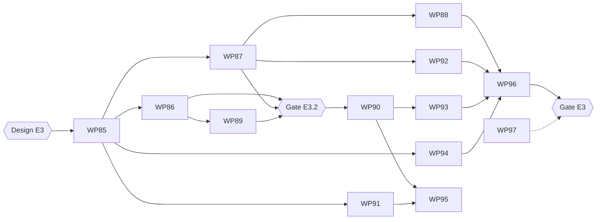

# Plan E3 — Evaluation of model connections

> Stand: 2026-10-25 · **Entschieden: D1–D12 und O1–O4, O7, O8 (2026-10-24), Design abgeglichen (5.1) · WPs WP85–WP97 · in `ep-3` gemergt: WP85–WP89 (E3.1–E3.2), Gate E3.2 bestanden (2026-10-25, Tag `e3.2`)** · Design: [design/e3/README.md](../design/e3/README.md) (Bildschirme V1–V8, `fixture/bewertung.json`, `screenshots/`), Briefing [design/e3/BRIEF.md](../design/e3/BRIEF.md) · Bezug: [anforderungen.md](../anforderungen.md) (F-3.1, F-3.3, F-3.6, F-3.8, F-3.13–F-3.18, F-9.3–F-9.6, F-10.3–F-10.5), [etappen.md 5](../etappen.md), [bewertung.md](../bewertung.md), [plan-e2.3-e2.6.md](plan-e2.3-e2.6.md), Messungen: [testplan-system-context.md](testplan-system-context.md) (8.1–8.5), [testplan-external-models.md](testplan-external-models.md), [benchmarks.md](benchmarks.md), Harness: [backend/evals/](../backend/evals/README.md)
>
> Integration branch **`ep-3`**: each WP is its own branch from it (`wpNN-…`), merged back with `--no-ff` after its gate and review; `ep-3` merges into `main` once every WP is done and Gate E3 is green. Same rules as E2: WP gate and code review per WP, etappe gates with `make gate`, acceptance test and a review of the integrated diff (section 5).

## 0 Where E3 starts

E2 built half of E3 under another name. The harness in `backend/evals` asks a real model through the production path (`direct_prompt`, `DirectQuery.ask`), grades each answer deterministically on the result (feature ids, `gold_any`, `require`, `expect`), repeats with seed blocks, sums by tag, keeps a held-out set and compares runs case by case with a sign test and a bootstrap interval. Four testplans have used it for some 400 runs. E3 moves that method into the application, for the administrator, and extends it from the sample data to the customer's own data and questions.

What the measurements decided for this plan:

| Finding | Source | Consequence here |
|---|---|---|
| Grading on the result was enough; no query normalisation was ever needed | harness, all runs | Stage 1 explains, it does not judge (D5) |
| Noise ±2 of 165 (gemma4:12b) to ±6 (qwen3:8b); seeds at temperature 0 hardly differ | testplan-system-context 2.5 | Two seed blocks per measuring point, paired statistics per case (D7) |
| Tuning on the same cases overfits; a held-out set was needed | testplan-external-models 9 | Every case belongs to the tuning or the confirmation split (D2) |
| Luna `n03`: no filter, the explanation claims one | testplan-system-context 8.2 | "silently wrong" flags (D6) |
| The best prompt variant differs per model (P5, P6(12), P9) | 8.2, 8.4 | Prompt profiles per connection, measured and set by the administrator (D9) |
| Code lists matter most for every model; a plain import costs more than the choice of model; confirming the import's code lists recovers most of it | 8.5 (Phase 4) | A run shows the state of the layer profile; a completeness indicator guides the administrator (D11) |
| About two thirds of the wrong answers without code lists return 0 hits | 8.5 | `zero_hits` flag (D6) |
| Runs take minutes, slow models up to 30 | benchmarks | Background run with polling, as the chain (E2 P4/P7) (D8) |

Decided before this plan (2026-10-23): E3 delivers **both** the release decision (which connection to approve and preset) **and** prompt profiles per model as production configuration; **no hand-corrected cases and no four-eyes confirmation** yet; **direct query first**, the tool chain later; **`backend/evals` stays** as a developer CLI and shares the grader with the application.

## 1 Decisions (decided 2026-10-24)

| # | Question | Proposal | Why |
|---|---|---|---|
| D1 | Data a case runs against | Two **data states**. *Beispieldaten*: the run builds a fresh, isolated SpatiaLite database from the packaged sample data (as the harness does), so the start set is reproducible whatever the live catalog holds. *Betriebsdaten*: the run uses the live catalog and the visibility of the administrator who starts it (D4). A case names its data state; a run uses one | bewertung.md 2 needs a fixed data state for comparable runs; the customer's question needs their own data. The sample run uses the same engine and checks, only another backend instance, so it is no side path past the engine (bewertung.md 6.3) |
| D2 | Case format and storage | One format for both: the harness's case (`id`, `prompt`, `tags`, `gold` · `gold_any` · `require` · `expect` with `also`, `forbid`, `other_approach`) plus `schema_version`, `data_state`, `split` (`tuning` · `confirm`), `note`, `origin` (`start` · `authored` · `import` · `log` with `origin_action`), `other_approach` as `chain` or `none` (unset: not checked), and for live cases the layers used with their `dataset_version` when the reference was last checked (D3). `other_approach: "none"` demands that no other approach is offered; an unset field checks nothing. An imported `authored` or `log` case becomes `origin: import` and drops its `origin_action` (an action id of another instance names nothing here). A draft (`CaseDraft`, V2 prefilled from M16.2) has no id and no tags until it is saved with `POST /cases`. Start set and own cases fit one case file: at most 500, so an instance holds at most 500 minus the start set (71) own cases. **Start set** = `cases.json` (33, `tuning`) and `heldout.json` (38, `confirm`), moved to `schema/eval-cases/` as the versioned artefact; the harness reads it from there. **Own cases** live in a table and export/import as the same JSON (F-3.13, F-10.4); a new own case defaults to `confirm` (design review 3) | The format has carried 71 cases through four testplans; one format means one grader and one import path |
| D3 | Reference result | The reference **query** is stored, the reference **result** is computed at run time from it on the same data state. A live case whose layers are gone or invisible is `stale` (as E2.6 `stale_reference`) and is left out of runs until it is edited; a live or sample case whose reference no longer passes the checks of a model query or no longer runs is `invalid` and left out alike (computed on read with staleness; the list checks without counting). One whose layer's `dataset_version` changed since its reference was last checked is run but marked "Datenstand geändert": the versions are stamped on creation and on an edit of the readings, `require` or layers, never on an edit of tags, note or split | Live data changes on re-import; a frozen fingerprint would turn every re-import into false failures. Answers "aging of cases" (bewertung.md 12) |
| D4 | Whose view a run uses | Sample runs: all sample layers. Live runs: the **administrator's own** visibility and profile (E2.2 S3); the run's label records the account. Running as another account is postponed (O3) | The profile is per account; the administrator's view is the simplest that is honest about it |
| D5 | Stages (F-3.16) | Stage 0 *formgültig*: the answer reads and passes the application's checks (as `DirectQuery.ask`). Stage 2 *ergebnisgleich*: the grader of the harness, unchanged, decides `pass`. Stage 1 *abfragegleich*: canonical form (E2's `canonical_json`, harmless shapes of E-3, `and`/`or` arguments sorted) compared with the reference; shown as a **diff** beside the verdict, never a verdict of its own. Tolerances: feature-id equality only; tolerances for aggregate outputs are postponed (section 9) | bewertung.md 4 says stage 2 judges and stage 1 explains; the harness proved that result equality with `gold_any` is enough. No E3 case has an aggregate output yet |
| D6 | Verdicts and flags | Verdicts as the harness: `pass`, `wrong`, `refused:<code>`, `kind:<kind>`, `other_approach`, `forbidden`, `error:<code>`. Flags on a `wrong` answer: `no_assumption` (the answer states no assumption) and `zero_hits` (the query returns nothing). "Silently wrong" = `wrong` with `no_assumption`; the matrix counts it on its own | Phase 4: the dangerous failure is the confident one; both flags are deterministic. A check of explanation against query stays out (no judge model, bewertung.md 11) |
| D7 | Repeats and statistics | A measuring point runs every case with **two seed blocks** (default 2 × 5) at the connection's temperature. A **Schnelltest** runs one block (or fewer repeats) for a first look; it shows rates and verdicts but never the comparison words below (O2). Each column is compared with a chosen reference column **paired per case**: wins, losses, mean difference with a 95 % bootstrap interval, sign test, as `compare.py --stats`. The matrix says *besser*, *schlechter* or *nicht belegt* (interval contains 0). The column's **rate** is taken on the `tuning` cases, the **comparison words** on the `confirm` cases (design review 1); a run without confirmation cases shows no comparison words, as a Schnelltest. Two runs are put side by side only when both are complete and ran the same cases | One block is a sample of one (bewertung.md 6.1); the per-case pairing is what made the testplans' decisions sound |
| D8 | Run execution | In-process background task, **one run at a time** for the whole instance (a local GPU serves one model well); the client polls the run as it polls a chain (E2 P4, P7). Abort stops before the next question; a `running` run found at start-up is closed `interrupted`, its answers kept. Within a run, measuring points on **different connections run at the same time**, points on the same connection one after another (the design's duration estimate is "parallel je Anbindung"; two local connections on one Ollama host still queue there, which the estimate accepts). Every model call goes through `LLMClient` with the connection's timeout; every query through the engine with the operating limits (F-9.5, F-9.6). A run writes **no** `model_action` records: it is a measurement, not use | bewertung.md 6 (same rules as operation, a run is no queue); the log stays the record of real use and its key figures stay clean |
| D9 | Prompt profiles (decision 1b) | A connection gets a **prompt profile**, chosen from measured presets, not free text: *Beispiele* (`standard` · `12`), *Platzierung* (`P0` · `P5` · `P9`), *Ausgabe* (`erzwungen` · `nur Text`; today implied by the host, X-8). Default `standard`/`P0`/`erzwungen` = today's prompt, byte for byte (prompt hash test). The prompt builder (`prompt.py`) gains these options; the harness variants of the same names call the builder, so app and harness send the same prompt (hash test per preset). P1, P2, P3, P4, P8 are not offered (8.2: they lose, or break E-8). A run can measure any preset without changing the connection; "Promptprofil übernehmen" in the matrix sets it on the connection after a confirmation listing what changes in operation (V6.4), audited as `llm_connection_changed` in the audit log (Administration › Protokoll). **Deviation from the design** (decided 2026-10-24, O8), which says "im Modellprotokoll vermerkt": the model log holds model actions only (D8), a configuration change belongs to the audit log | E2 showed the best placement is per model; free text would make every installation its own unmeasured prompt |
| D10 | System prompt under test (F-3.6, bewertung.md 10) | A measuring point names a level; optionally an **edited copy** of that level's system prompt, used only by the run and stored with it (hash in the label). Operation is untouched | The third E2 prerequisite; lets the demo compare two system prompts on one connection |
| D11 | State of the layer profile | Every run records the profile hash and a **completeness summary** of the profile it used: share of attributes with a label other than their name, text attributes with a confirmed code list, layers and attributes with a description. The matrix header shows it; the profile page (*Was das Modell sieht*) shows the same summary with the order of care from Phase 4: confirm code lists, then labels, then descriptions that state meaning rather than joins. Descriptions are the third and lowest step (Phase 4: no measurable effect on average). *Text attributes* in the code-list share are those with a code list, confirmed or proposed by the import: free text and a categorical column the proposer skipped are not counted, so the share can reach 100 %. An attribute counts as labelled when its label differs from its column name, case ignored. The sample data is complete in code lists, not in labels and descriptions (WP94) | Phase 4: on customer data the metadata decides as much as the model; without this, poor metadata reads as a weak model |
| D12 | Cost and external connections | Before a run starts, the dialog shows the number of model requests per connection an estimate of the tokens (profile estimate S5 × requests) and of the duration (median latency of the connection's last run, else of its connection test), and for an external connection the notice of F-9.4 (the profile leaves the house, never data contents, F-9.3). The connection gets optional prices per million input and output tokens (O4); with them the estimate and the run's actual cost (from the reported tokens) show in money, without them in tokens only. Run requests **do not count** against the connection's daily request limit (E2 P5), which caps use, not measurement; the confirmation dialog is the cap | bewertung.md 6.4 and 12; a run over 71 cases × 10 is 710 requests, far above a daily limit of 50 |

## 2 What a run measures

Per measuring point (connection × prompt profile × level/system prompt), over the selected cases:

| Figure | From |
|---|---|
| Pass rate, by split and by tag | verdicts |
| Silently wrong, zero hits | flags (D6) |
| Not readable / refused / errors, by code | verdicts `error:*`, `refused:*` |
| Behaviour cases met (`expect` cases) | verdicts |
| Latency median and 90th percentile | `latency_ms` per answer |
| Tokens in/out, cost | reported tokens (D12) |
| Answers that ran into a limit | `error:llm_timeout`, `limit_exceeded` |
| Difference to the reference column | D7 |

The run's label (F-3.18): schema version, version of the grading rules, data state (sample version or live with dataset versions), profile hash and completeness (D11), level and system prompt hash, connection snapshot (model, host, temperature, effort, prompt profile), seeds, case set and split, account (D4), time, who started it. Runs are kept and any two can be put side by side.

## 3 Workstreams and file ownership

| Stream | Owns | WPs |
|---|---|---|
| **BE-eval** | `backend/src/geotandem/evaluation/` (new: `cases.py`, `grade.py`, `stats.py`, `store.py`, `diff.py`, `stages.py`, `sample.py`, `profiles.py` (the Phase 4 modes, moved from `evals/`), `run.py`), `api/evaluation.py`, migrations 0015–0016 | WP86, WP87, WP89, WP90, WP92 |
| **BE-prompt** | `backend/src/geotandem/model/prompt.py`, `llm/openai_compat.py` (output mode), `backend/evals/variants.py`, migration 0017 | WP91 |
| **BE-record** | `model/record/`, migration 0014 | WP86 (tokens) |
| **FE-eval** | `frontend/src/admin/evaluation/` (new) | WP88, WP93 |
| **FE-profile** | `frontend/src/admin/ProfilePage.tsx`, `ConnectionsPage.tsx` (prompt profile, price), `evaluation/summary.py` | WP91 (connection form), WP94 |
| **FE-workplace** | the "Als Prüffall speichern" entry in the workplace (admin only) | WP88 |
| **Contract** | `geotandem/evaluation/schemas.py`, `schema/eval-cases/`, `frontend/src/test/eval-mocks.ts` | WP85; later only by the integrator, with `make gen` |
| **E2E** | `e2e/tests/acceptance-e3.spec.ts`, `e2e/model-stub/` (scripted answers per seed) | WP96 |

Shared files as in E2 (`de.po` by extraction only, generated artefacts by `make gen`, routes and error codes registered up front in WP85). Migrations: **0014** model action tokens (WP86), **0015** cases (WP87), **0016** runs and answers (WP90), **0017** prompt profile and prices on the connection (WP91). No other WP creates one.

## 4 Work packages

Legend as in plan E2: **Deps**, **Parallel with**, **Done when** beyond the WP gate.

### Etappe E3.1–E3.2 — Cases and grading

#### WP85 — Contract freeze (serial, small, first)
*Deps: design handoff E3 (O1) · Parallel with: none* · **merged**

- Docs: CONTEXT.md — *Prüffall*, *Datenstand*, *Messpunkt*, *Bewertungslauf*, *Promptprofil*, *still falsch*. anforderungen.md F-3.13–F-3.18 annotated with D1–D12 (F-3.13 "Referenzergebnis und Toleranzen" read as D3/D5). bewertung.md 12: the open points marked as settled by this plan.
- `evaluation/schemas.py`: `EvalCase` and `CaseDraft` (D2), `CaseFile`, `MeasuringPoint` (connection id, prompt profile, level id, optional system prompt), `RunRequest` (points, case filter by split/tag/origin, data state, seed blocks or Schnelltest), `RunView` (status, progress, label, figures of section 2), `AnswerView` (verdict, flags, latency, tokens, answer, query, refusal, stage-1 diff), `PointComparison` and `RunComparison` (D7), `RunCase` (the cases as the run asked them, H7), `ProfileSummary` (D11), `CostEstimate` (D12). JSON schema of the case file in `schema/eval-cases/`.
- Routers `api/evaluation.py` under `/api/admin/evaluation/*`, admin only, every route 501 naming its WP; error codes `case_invalid`, `case_id_taken`, `case_read_only`, `case_stale`, `no_cases`, `action_not_eligible`, `run_busy`, `external_not_confirmed`, `runs_not_comparable` (`nothing_to_compare` is taken by E2.5).
- **Done when:** `make gen` clean, contract test validates the start set against the case schema, every stub route needs an admin session.

#### WP86 — Shared grader and tokens on the record (BE-eval, BE-record)
*Deps: WP85 · Parallel with: WP87, WP91* · **merged**

- Move `grade`, `conditions`, `matches`, `query_of` from `evals/run.py` to `evaluation/grade.py` and the paired statistics of `evals/compare.py` to `evaluation/stats.py`; the harness imports both. Add the flags of D6.
- Migration 0014: `prompt_tokens`, `completion_tokens` on `model_action`, written by the direct query and each chain call (the E2 prerequisite of bewertung.md 10 that was only half done: latency is stored, tokens are only logged).
- **Done when:** `evals/regrade.py` over all stored result files gives byte-identical verdicts before and after the move (recorded answers are the pytest fixture of the grader, bewertung.md 9); stats reproduce the numbers of testplan-system-context 8.4 and 8.5 from their result files.

#### WP87 — Case store, import and export, data states (BE-eval)
*Deps: WP85 · Parallel with: WP86, WP91* · **merged**

- Migration 0015 `eval_case`; `CaseStore` with create, edit, delete, list by split/tag/origin/data state; import and export of the D2 format (round trip unchanged, F-3.13); the start set is read from `schema/eval-cases/` and not editable in the UI (a copy can be made into own cases).
- Data states (D1): `sample_backend()` builds the isolated sample database once per process (`evaluation/sample.py`, the harness builds it alike) and opens it read-only; `live` uses the catalog. Staleness and invalidity (D3) computed on read.
- Validation: a gold query must pass the application's checks on its data state, `expect` names a known answer kind, at least one tag, a split.
- **Done when:** round trip of the start set and of a live case leaves the JSON unchanged (same keys and values); a case on a deleted layer reads `stale`; a re-imported layer marks "Datenstand geändert"; import of a case with an invalid gold query answers `case_invalid` naming the case.

#### WP88 — Case pages and "Als Prüffall speichern" (FE-eval, FE-workplace)
*Deps: WP87, design · Parallel with: WP89* · **merged**

- Admin › Modell › **Bewertung › Prüffälle**: list with split, tags, origin, data state, stale mark; detail with question, reference shown as the readable condition tree of E2 (not JSON) with the hit count per condition (as B2), "im Arbeitsplatz öffnen", a further reading (`gold_any`); behaviour cases with their expected kind; import/export.
- Workplace, admin only: **Als Prüffall speichern** takes the query of the current analysis as reference (`analysis/query.ts`, as Modus A runs it) and asks for the question as a user would word it, tags and split. The query must pass the checks a model query passes (WP87 validation, e.g. the limit of 8 conditions).
- **Done when:** component tests per state. That an authored case runs and passes against its own reference is checked in WP90 (no runs before it).

#### WP89 — Stages 0–2 and the stage-1 diff (BE-eval)
*Deps: WP86 · Parallel with: WP88* · **merged**

- Stage 0 and 2 from the shared grader; stage 1 as a structural diff of canonical forms (D5): added, missing and changed conditions with their path, the layer, the predicate, the distance.
- Behaviour cases: `expect` as today; `also` accepted kinds.
- **Done when:** the cases of bewertung.md 4 hold as tests: a differently worded but correct query passes with a non-empty diff; a query similar to the reference but wrong fails with a diff that names the difference; recorded answers of the testplans are the fixtures.

#### Gate E3.2
Internal (no UI release): WP gates, `make gate`, `/code-review xhigh` of the etappe's diff, the regrade identity of WP86 re-run on main.

**Passed 2026-10-25** on `ep-3` (tag `e3.2`):

- WP gates and independent reviews of WP85–WP89, every finding fixed or answered in the merge commits.
- Review of the integrated diff (`git diff E2...ep-3`, effort xhigh): seams between the WPs. Fixed on `ge32-fixes`: `require` conditions as a strict model (two shapes crashed the grader), rules for `also` and `forbid`, an own case shadowed by a start id stays reachable, `RunCase` carries the whole case, the status *ungültig* (`invalid`) for a reference that no longer runs, one reading helper, one sample build (`evaluation/sample.py`), the ablation modes in `evaluation/profiles.py`, bounds on every case field, `no_cases` refused at the start of a run, versions restamped only when the reference changes, docs aligned.
- `make gate` green twice (before and after the fixes): 1891 backend tests, 725 frontend tests, Playwright 66 passed on both passes, restart included; the only skip is E2.1 without `GATE_LLM_MODEL`.
- Regrade identity on `ep-3`: the 22 labels of Phases 1–4 (four local models, Haiku, Luna; P0, P9, ablation modes) regrade with 0 changed verdicts; all 269 labels give the same verdicts as before the fixes.

Open for E3.3–E3.5: WP92 adds the eligibility check also on `POST /cases` with origin `log`; WP90 leaves out stale and invalid cases, keeps the readings once per case (`grade.reading_ids`) and treats a failing reading as a case problem.

### Etappe E3.3–E3.5 — Runs, prompt profiles, comparison

#### WP90 — Run engine (BE-eval)
*Deps: Gate E3.2 · Parallel with: WP91 (merges first or rebases), WP92*

- Migration 0016 `eval_run`, `eval_answer`. `POST /runs` (202) after the cost estimate (`POST /runs/estimate`, D12); `GET /runs/{id}` polled; `POST /runs/{id}/abort`; one run at a time (`run_busy`); restart closes `interrupted` (D8).
- Per measuring point: the prompt as operation builds it (level, profile of the data state and account, prompt profile, optional system prompt copy, D10), `DirectQuery.ask`, grade, store the answer with latency, tokens, flags, diff. No `model_action` rows; the engine's limits apply.
- External connections: the F-9.4 notice is part of the estimate; the run refuses an external connection the administrator has not confirmed in this request.
- **Done when:** a run against the model stub over the start set reproduces the stub's scripted verdicts; abort and restart tested; a sentinel test shows no row value in any prompt of a live run (E2 S7); the run never writes `model_action`.

#### WP91 — Prompt profiles (BE-prompt, FE-profile)
*Deps: WP85 · Parallel with: WP86, WP87*

- `prompt.py` gains `PromptProfile(examples, placement, output)` (D9); `examples/12.txt` moves into the application; P5 and P9 as builder options, P9 with its own system message (E-8 extended 2026-10-23). The harness's `--variant p5|p9` and `--examples 12` call the builder.
- Migration 0017: `prompt_profile` (JSON, default today's) and optional prices on `llm_connection`. Connection form: three selects and the prices; change audited.
- Operation uses the connection's profile for the direct query; the chain keeps the default until the chain is evaluated (postponed, 9).
- Security review entries: P9 adds a system message, the user message stays the prompt text only (E-8 invariant, bypass test as E2).
- **Done when:** the default profile sends today's prompt byte for byte (hash `55e708badb92` on the harness's placeholder question); each preset's hash equals the harness variant's; the connection form tests.

#### WP92 — Cases from the log (BE-eval, FE-eval)
*Deps: WP87 · Parallel with: WP90*

- On the admin's model action page (M16.2): **Als Prüffall übernehmen** for a direct query with decision `accepted` or `auto`, neither undone, not touched, not a follow-up (F-3.14). Hand-corrected answers (`adjusted`, `touched_at`) and follow-ups (`parent_action_id`) are not offered (decision 2). It opens the case page (V2) prefilled with the prompt, the stored query as reference, `data_state` live, the layer names (the save stamps the versions, D3) and `origin: log` with `origin_action`; the case is stored only when the admin saves it with tags and split. `POST /cases` with `origin: log` checks the same eligibility (`action_not_eligible`), so a case cannot be taken from an adjusted action by hand.
- **Done when:** a logged, accepted action becomes a case without typing the query; an adjusted one shows no button; the created case passes against itself.

#### WP93 — Run dialog, matrix and case detail (FE-eval)
*Deps: WP90, design · Parallel with: WP94*

- **Bewertung › Läufe** (V5): list of runs with label and status, an empty state that proposes the smallest first run; **Neuer Lauf**: measuring points (connection, prompt profile, level, optional system prompt copy), cases (split, tags, origin), data state, full run or Schnelltest; estimate and external notice before start; progress while running, abort.
- **Matrix** (F-3.18, V6): cases (grouped by tag, with group sums) × measuring points; cell = passes of 10 with the verdict mix in short form, "still falsch" as dashed frame, "!" and text; column heads only once the run is done (design review 5); column head = section 2 figures, profile completeness (D11; `ProfileCompleteness` of WP94 in V6.3, and V8.1's line from a layer's gaps to the run's result, which WP94 left for this WP), and the comparison to the chosen reference column (D7) in words: *besser*, *schlechter*, *nicht belegt*.
- **Case detail**: question, reference, per seed the answer (explanation, assumptions, verdict, flags), the stage-1 diff, both result sets as counts and the differing feature ids; "im Arbeitsplatz öffnen" for the reference and for an answer's query.
- Actions from the matrix: **Promptprofil übernehmen** (D9), and a link to the connection page, where it is approved or preset (F-3.3, F-3.8; design review 6). Two runs side by side (D7). **Exportieren** of a run (its answers and figures as JSON). A Schnelltest offers **Als vollständigen Lauf wiederholen**, which opens V4 prefilled. The connections page shows "zuletzt bewertet" with a link to the run (administrators only, O7).
- **Done when:** component tests per state against mocks; the demo of etappen.md 5 can be walked with the stub.

#### WP94 — Profile completeness (FE-profile, BE `evaluation/summary.py`)
*Deps: WP85 · Parallel with: WP93*

- `ProfileSummary` (D11) from the profile; shown on *Was das Modell sieht* and in each run's label; per layer the gaps in the order of care (code lists not confirmed, attributes without label, without description); the import's last step links there.
- **Done when:** the summary of the sample data and of each Phase 4 mode (`evaluation/profiles.py`, which the harness imports) matches a hand count in a test.

#### WP95 — Real-model check of the application run (integrator)
*Deps: WP90, WP91*

- A run in the application with gemma4:12b over the start set's tuning split, two blocks, P0, must land within the noise of the harness's P0 (272/330 ± 10) with the same prompt hash; a second point with Haiku or Luna only with the administrator's confirmation. Result recorded in this plan.
- **Result (2026-10-25, `ep-3` at `130b48e`):** one run in the application (`geotandem serve` on a fresh data directory with the sample, set up over the API), one measuring point: a local connection to Ollama (`http://127.0.0.1:11434/v1`) with gemma4:12b, temperature 0.3, reasoning effort `none`, a seed set (so the run sends seeds 1–10), no context length, the connection's own prompt profile P0 (standard examples, constrained output), level *Prüfen*; start set, tuning split, 33 cases, full scope. **272/330 passed (blocks 135 + 137), the harness's P0 has 272/330**: difference 0, inside ±10. Per case equal everywhere, and the verdict class of every one of the 330 answers (by case and seed) equals the harness's (`20261025-090549/-090554-p0-gemma4_12b*.jsonl`); 56 answers differ only in free text (explanation, clarification wording), none in the verdict. The run labels the verdict without the harness's detail suffix (`kind` vs `kind:cannot_answer`), wording only. Prompt hash of the application's builder for the placeholder question, with the app's level and the run's sample world: `55e708badb92…` (`55e708badb92a05fae633636946292a947435f6553903966482311dd9c6a2eb2`), equal to the harness header; the layer profile hash of the run label (`32381546…`) is the harness's sample. Latency median 1.13 s (harness 1.40 s); no answer errored or timed out (the run caps a call at 120 s, the harness at 300 s, not reached). Duration 6 min 56 s for 330 answers (the estimate said 55 min). A second point with an external model was not run.
- **Finding (open for Gate E3):** the estimate's duration was 8 times too high. The connection had no earlier run and no connection test, so the estimate fell back to its default of 10 s per answer (`DEFAULT_LATENCY_S`). A connection test or a first run fixes it for that connection; whether the default itself should be lower, or the dialog should say the duration is a rough guess without measurements, is decided at Gate E3.

#### WP96 — E3 acceptance (E2E)
*Deps: WP88, WP92, WP93, WP94*

- `acceptance-e3.spec.ts` against the stub (answers scripted per seed): the demo of etappen.md 5 — two connections over the same cases, the matrix carries the release decision, a second run compares two system prompts on one connection; an authored case and a case from the log; abort; an external connection's notice; a stale live case.

#### WP97 — Docs and wrap-up (docs)
*Deps: WP96*

- README "Bewertung im Einsatz"; user journey of the administrator choosing a model on own data; etappen.md E3 marked done; bewertung.md updated where the plan amends it (D5 stage 1, D8 no action records, D12 quota); testplan cross-references.

#### Gate E3
As 5.2 of plan E2, plus: the real-model check WP95 (recorded), the security review (section 5) and the regrade identity of WP86.

## 5 Gates and reviews

As plan E2, section 5: WP gate (lint, tests, `make gen`, security list, `/code-review high`, `/simplify`), etappe gate on main (`make gate` with two Playwright passes and restart, audit, `/code-review xhigh` of the integrated diff, design walk, docs). Review effort `medium` for WP85's docs, WP96 and WP97.

**Security review at Gate E3** (update [security-review.md](../security-review.md)): admin-only on every `/api/admin/evaluation/*` route; a run's model calls go only through `LLMClient` and its queries only through the engine with the operating limits; no row value reaches a prompt (sentinel); a live run uses exactly the starting administrator's visibility (D4); external runs only after the notice (D12); import of cases cannot inject queries past the checks (a gold query is validated as a model query is); the P9 system message keeps the E-8 invariant; prices and tokens leak no key.

### 5.1 Design conformance

Handoff received 2026-10-24 ([design/e3/README.md](../design/e3/README.md)); its six review decisions are taken into D2, D7, D9 and WP93. Also taken from the screenshots: measuring points on different connections run in parallel (D8), the grading rules' version in the label (section 2), export of a run and "Als vollständigen Lauf wiederholen" (WP93). One deviation: applying a prompt profile is recorded in the audit log, not the model log (D9). The screenshots still show `attr-franzoesisch` at 0 of 10; the README and the fixture are authoritative. The handoff's open point (`attr-franzoesisch` at 0 of 10) came from a misreading of the brief and is settled there: under P0 every measuring point has 10 of 10, the fixture is corrected.

| WP | States checked against `design/e3/screenshots/` |
|---|---|
| WP88 | V1.1–V1.4, V2.1–V2.3, V3.1–V3.2 |
| WP92 | V2.1 prefilled from M16.2 |
| WP93 | V4.1–V4.2, V5.1–V5.2, V6.1–V6.6, V7.1–V7.5 |
| WP94 | V8.1–V8.2 |

## 6 API surface (frozen in WP85)

| Route | WP | Notes |
|---|---|---|
| `GET/POST /api/admin/evaluation/cases` · `GET/PUT/DELETE …/cases/{id}` | 87 | own cases; start set read-only |
| `POST …/cases/import` · `GET …/cases/export` | 87 | D2 format |
| `GET …/cases/draft-from-action/{action_id}` | 92 | a prefilled case, stored only by `POST …/cases` (V2 from M16.2); accepted or auto-not-undone only |
| `POST …/runs/estimate` · `POST …/runs` (202) | 90 | D12, D8; a selection without a runnable case is refused at the start, 400 `no_cases` |
| `GET …/runs?connection_id=` · `GET …/runs/{id}` · `POST …/runs/{id}/abort` | 90 | polled; the filter gives "zuletzt bewertet" of a connection (O7) |
| `GET …/runs/{id}/answers?case_id=…&point=…` | 90 | case detail |
| `POST …/comparison` | 90 | two complete runs over the same cases (V6.6); the columns of one run are compared with its reference column in `RunView`, D7 |
| `GET …/runs/{id}/export` | 90 | answers and figures as JSON |
| `GET …/profile-summary?data_state=&account=` | 94 | D11, as `GET /api/admin/llm/profile` for one account |
| connection: `prompt_profile`, prices | 91 | extends the E2.1 routes |

## 7 Order and parallelism

| Wave | WPs in parallel | Needs |
|---|---|---|
| 0 | WP85 | design |
| 1 | WP86 · WP87 · WP91 · WP94 | WP85 |
| 2 | WP88 · WP89 | WP87 · WP86 |
| — | **Gate E3.2** | |
| 3 | WP90 · WP92 | gate · WP87 |
| 4 | WP93 · WP95 | WP90 (WP95 also WP91) |
| 5 | WP96 · WP97 | wave 4 |
| — | **Gate E3** | |

## 8 Open points

Decided 2026-10-23 and 2026-10-24:

| # | Question | Decision |
|---|---|---|
| O1 | Design | A design pass like E2 before WP85: brief in [design/e3/BRIEF.md](../design/e3/BRIEF.md), screens V1–V8; WP88, WP93 and WP94 build against the handoff (received 2026-10-24, 5.1) |
| O2 | Fewer repeats | A **Schnelltest** (one block, or fewer repeats) for a first look, without the comparison words of D7; the full run keeps two blocks |
| O3 | Live runs as another account | Not in E3: the administrator's own view first (D4) |
| O4 | Prices | Optional price fields on the connection; estimate and cost in money where set (D12) |
| O7 | "zuletzt bewertet" | Administrators only in E3, on the connections page; a user-facing mark later (decided 2026-10-24) |
| O8 | Where applying a prompt profile is recorded | The audit log (Administration › Protokoll), not the model log, as D9 (decided 2026-10-24) |

Still open, not blocking:

| # | Question | Proposal |
|---|---|---|
| O5 | `zero_hits` as a hint in operation | Phase 4 finding 5; not in E3, a candidate for after it (9) |
| O6 | Generated starter cases from the profile (memo, point 4) | Not in E3; revisit when the first customer data is in |

## 9 Postponed

- **Tool chain evaluation** (E3.6, its own package after Gate E3): the chain's final state as a query object (bewertung.md 4), step count and limit figures, the chain's prompt profile.
- **E-7, values and synonyms in the profile**: E3 provides the measurement (Phase 4 mode `raw-codes` shows where the local models still lose); deciding and building it is its own step.
- **Hand-corrected cases and four-eyes confirmation** (decision 2).
- **Tolerances for aggregate outputs** (D5), once a case has one.
- **Live runs as another account** (O3).
- **"zuletzt bewertet" for users** (O7).
- **Free-text prompt profiles** and automatic prompt optimisation (bewertung.md 11).
