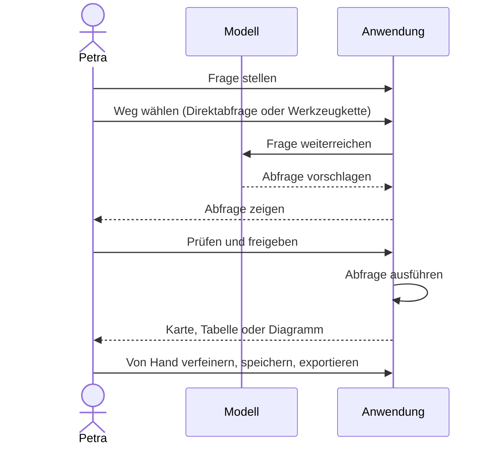
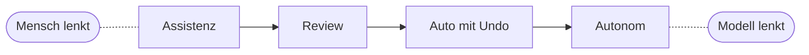
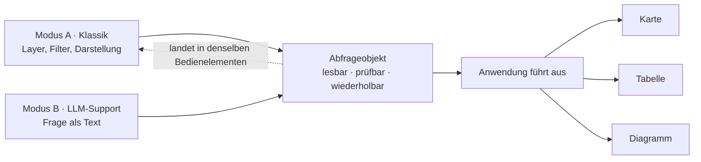
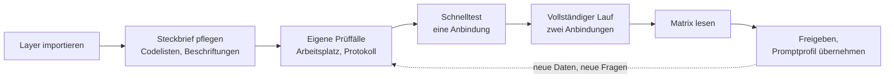
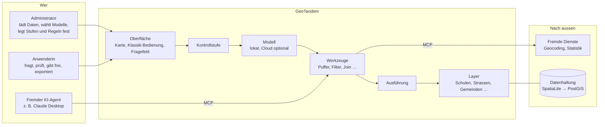
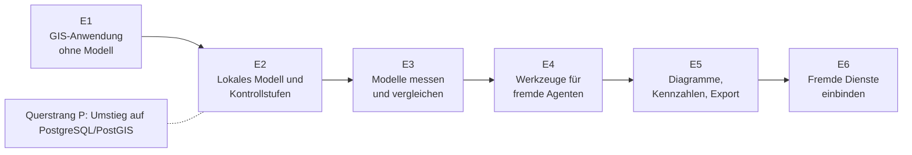

# GeoTandem — User Journey

> Für alle, die neu dazukommen. Die technische Begründung steht in
> [vision.md](../vision.md), das Vokabular in [CONTEXT.md](../CONTEXT.md).

## 1 Die Idee in drei Sätzen

Man stellt eine räumliche Frage in normaler Sprache. Das Modell schlägt eine
Abfrage vor. Der Mensch entscheidet, wie genau er sie vorher sehen will.

| Für wen | Was neu ist | Was bleibt |
|---|---|---|
| Fachleute in Verwaltung und Fachstellen, die keine GIS-Spezialisten sind. | Wie viel das Modell ohne Rückfrage tun darf, ist einstellbar. | Jedes Ergebnis lässt sich als lesbare Abfrage nachprüfen und ohne Modell wiederholen. |

Der Name ist das Bild: Mensch und Modell fahren Tandem. Wer lenkt, lässt sich
einstellen.

## 2 Petras Frage

Petra arbeitet im Schulamt der Beispielregion Bern-Mittelland und hat kein
GIS-Training. Ihre Frage:

> *„Welche Schulen liegen im 500-Meter-Umkreis von Hauptverkehrsstrassen in
> Gebieten mit hohem Kinderanteil?"*

Ohne GeoTandem müsste sie diese Frage zuerst in Layer, Puffer und Filter
übersetzen. Mit GeoTandem läuft es so (hier in der Stufe *Review*):

Die Schritte im Einzelnen:

| # | Schritt | Wer | Was passiert |
|---|---|---|---|
| 1 | Frage stellen | Mensch | Petra tippt ihre Frage ins Fragefeld. |
| 2 | Weg wählen | Mensch | *Direktabfrage* für eine klar umrissene Frage, *Werkzeugkette* für eine offene. Petra entscheidet pro Frage. |
| 3 | Abfrage entwerfen | Modell | Das Modell übersetzt die Frage in eine lesbare Abfrage: Schulen, nahe Hauptstrassen, 500 m, hoher Kinderanteil. |
| 4 | Prüfen und freigeben | Mensch | Petra sieht die Abfrage vor der Ausführung. Ein falscher Layer fällt hier auf, bevor er auf der Karte überzeugend aussieht. |
| 5 | Ausführen | Anwendung | Die Anwendung führt die Abfrage aus. Das Modell fasst die Daten nie selbst an. |
| 6 | Ergebnis ansehen | Mensch | Karte, Tabelle oder Diagramm erscheinen. |
| 7 | Weiterarbeiten | Mensch | Petra verfeinert in der Klassik-Bedienung, speichert die Sitzung und exportiert. |

## 3 Der Regler: wie viel darf das Modell allein?

Die **Kontrollstufe** (im Projekt: HITL-Stufe, *Human in the Loop*) legt fest,
wo Petra eingreift. Der Administrator gibt den Rahmen vor, Petra wählt darin.

So ändert sich Petras Journey je nach Stufe:

| Schritt | Assistenz | Review | Auto mit Undo | Autonom |
|---|---|---|---|---|
| 3 Modell | erklärt, was passen würde | entwirft die Abfrage | entwirft die Abfrage | plant mehrere Schritte selbst |
| 4 Vor der Ausführung | Petra klickt selbst zusammen | **Freigabe** | entfällt | entfällt |
| 6 Nach der Ausführung | ansehen | ansehen | Änderung sehen, **zurücknehmen möglich** | **Endergebnis bestätigen** |

Die vier Stufen sind ein Vorschlag (Option A in [vision.md 8.1](../vision.md)).
Wie die Stufen geschnitten werden, ist bewusst noch offen. Der Demonstrator soll
das ausprobieren.

> **Hinweis:** Die wählbaren Optionen im Werkzeug sind auch für
> Usability-Tests gedacht: Modus A oder B, Direktabfrage oder Werkzeugkette
> und die einzelnen Kontrollstufen. Dieselbe Frage lässt sich so mit verschiedenen
> Einstellungen durchspielen, und Tests zeigen, welche Variante Anwenderinnen
> und Anwender verstehen und ihr vertrauen.

## 4 Zwei Modi, ein gemeinsamer Zustand

GeoTandem lässt sich auf zwei Arten bedienen:

- **Modus A · Klassik:** Layer wählen, Filter setzen, Darstellung gestalten.
  Funktioniert auch ganz ohne Modell.
- **Modus B · LLM-Support:** Die Frage als Text stellen.

Beide erzeugen dasselbe: eine lesbare Beschreibung der Analyse, das
**Abfrageobjekt**. Erst die Anwendung macht daraus ein Ergebnis.

Das Modell ersetzt die Oberfläche nicht, es füllt sie aus. Was das Modell
vorschlägt, kann man danach von Hand weiterbearbeiten. Umgekehrt kann eine von
Hand gebaute Analyse der Ausgangspunkt für eine Frage sein.

### Petras Frage in Modus B

Petra tippt ihre Frage ins Feld: «Welche Primarschulen liegen nahe an
Kantonsstrassen, in Gemeinden mit hoher Steueranlage?» Das Modell antwortet mit
seiner Lesart und den Annahmen, die es dafür trifft («nahe» heisst höchstens
500 m, «hohe Steueranlage» über 1.6), und mit dem Abfrageobjekt. Auf der
Stufe *Prüfen* sieht sie, was sich an ihrer Analyse ändern würde und wie viele
Schulen übrig blieben, und nimmt an. Die drei Bedingungen stehen jetzt im
Editor, markiert mit «Modell».

Sie öffnet den Editor und ändert 500 m auf 300 m; die Marke dieser Zeile fällt
weg. Dann fragt sie weiter: «Welche davon haben mehr als einen Standort?» Über
dem Feld steht *Bezug: aktuelle Analyse*: Das Modell erfährt, dass sie den
Stand von Hand geändert hat, und ergänzt ihre Analyse statt seiner alten
Antwort. Hätte sie lieber neu angefangen, hätte ein × die Frage ohne Bezug
gestellt.

Geht etwas schief (das Modell antwortet nicht, oder die Antwort nutzt einen
Layer, den es nicht mehr gibt), sagt die Anwendung das in Worten, und Petras
Stand ist unverändert.

## 5 Die Administratorin wählt ein Modell für eigene Daten

Andrea betreut GeoTandem für das Bauamt einer Gemeinde. Zwei Anbindungen
stehen zur Wahl: ein lokales Modell auf dem Server im Haus und ein externes
über die API eines Anbieters. Welche soll sie für Petra und ihre Kolleginnen
freigeben? Der Verbindungstest sagt nur, dass beide antworten. Ob sie die
Fragen des Bauamts zu dessen Layern richtig beantworten, sagt er nicht. Das
misst die **Bewertung** (*Administration › Modell › Bewertung*). Petra
bekommt davon nichts zu sehen.

**Erst der Steckbrief.** Andrea importiert den Layer der Parzellen mit dem
Zonenplan. Der letzte Schritt des Imports verweist auf den Stand des
Steckbriefs unter *Was das Modell sieht*. Dort steht, was dem Modell fehlt,
in der Reihenfolge, in der es sich zu pflegen lohnt. Zuerst die Codelisten:
Der Import hat für die Zone die Codes `W2`, `WG3` usw. vorgeschlagen, aber
erst eine bestätigte Liste erreicht das Modell. Danach die Beschriftungen,
etwa «Bruttogeschossfläche» statt `bgf`, denn sie verbinden Petras Wörter mit
den Spalten. Zuletzt Beschreibungen, die sagen, was ein Feld bedeutet. Die
Messungen hinter dieser Reihenfolge zeigen: Ein schlichter Import kostet mehr
als die Wahl des Modells.

**Eigene Prüffälle.** Die 71 Fälle des Startbestands laufen auf den
Beispieldaten. Über die Layer des Bauamts sagen sie nichts. Andrea baut im
Arbeitsplatz die Analyse für «Welche Parzellen in der Zone W2 sind grösser als
1000 m²?», prüft das Ergebnis und speichert sie mit *Als Prüffall speichern*.
Die Frage tippt sie so, wie Petra sie stellen würde. Im Modellprotokoll findet
sie eine Frage, die Petra gestellt und angenommen hat, und übernimmt sie mit
*Als Prüffall übernehmen*, ohne die Abfrage abzutippen. Eine Antwort, die
Petra von Hand korrigiert hat, bietet den Knopf nicht an. Neue Fälle gehören
zur *Bestätigung*. Einen Teil ihrer Fälle legt Andrea in die *Abstimmung*:
Auf diesen Fällen rechnet die Matrix die Quote, auf den Fällen der
Bestätigung den Vergleich. Mit *Exportieren* sichert sie den Bestand als
Datei, die sich wieder importieren lässt.

**Ein Schnelltest.** Für einen ersten Blick wählt Andrea im neuen Lauf nur
das lokale Modell, ihre eigenen Fälle auf den Betriebsdaten und den
*Schnelltest*: fünf Wiederholungen je Fall statt zehn. Die Abschätzung nennt
Anfragen und Dauer, bevor etwas gesendet wird. Ein Fall fällt auf: «still
falsch», gestrichelt umrandet. Das Modell hat sicher geantwortet und keine
Annahme genannt, und die Antwort ist trotzdem falsch. Im Fall im Lauf zeigt
der Unterschied zur Referenz, dass es ein anderes Attribut verglichen hat;
die Ergebnismengen zeigen 0 Treffer gegen 14. Das Attribut hat noch keine
Beschriftung. Andrea ergänzt sie.

**Ein vollständiger Lauf mit zwei Anbindungen.** Jetzt richtet sie drei
Messpunkte ein: das lokale Modell mit seinem Promptprofil als
Vergleichsbasis, dasselbe Modell mit der Platzierung P5 und das externe
Modell. Die Abschätzung zeigt die Anfragen je Anbindung, die Tokens und, weil
an der externen Anbindung Preise stehen, die Kosten. Dazu kommt der Hinweis,
dass Steckbrief und Fragen an den Host des Anbieters gehen, aber keine
Geodaten-Inhalte. Erst mit dem Haken lässt sich der Lauf starten. Er läuft im
Hintergrund; die beiden Hosts arbeiten gleichzeitig. Andrea schliesst die
Seite und kommt später wieder.

**Die Matrix lesen.** Die Spaltenköpfe erscheinen, wenn der Lauf fertig ist.
Das externe Modell hat die höchste Quote auf der Abstimmung; gegenüber der
Vergleichsbasis sagt die Matrix auf der Bestätigung *nicht belegt*. Die
Spanne des Unterschieds schliesst 0 ein, der Vorsprung ist also nicht
belegt. Das lokale Modell mit P5 ist *besser* als mit seinem bisherigen
Profil und hat nicht mehr still falsche Antworten. Die Beschriftung des Laufs
hält fest, wogegen gemessen wurde: Datenstand, Stand des Steckbriefs (Codelisten
vollständig, Beschriftungen noch nicht), Modell, Promptprofil, Stufe, Seeds.
Ein schwacher Wert lässt sich so nicht mit einer Lücke in den Metadaten
verwechseln.

**Entscheiden.** Über *Zur Anbindung* gibt Andrea auf der Seite
Modellanbindungen das lokale Modell frei und setzt es als Standard. Mit
*Promptprofil übernehmen* setzt sie für diese Anbindung P5. Der Dialog nennt,
was sich im Betrieb ändert, und dass es alle Anwender dieser Anbindung
betrifft. Die Änderung steht im Sicherheitsprotokoll; das Modellprotokoll
bleibt die Spur der echten Benutzung, denn der Lauf selbst hat keine
Modellaktion geschrieben und nicht gegen die Tagesgrenze gezählt. An der
Anbindung steht jetzt *zuletzt bewertet* mit einem Verweis auf den Lauf.

Wird der Layer später neu importiert, tragen die Fälle darauf *Datenstand
geändert* und laufen weiter mit. Fehlt ein Layer, sind seine Fälle
*veraltet* und bleiben draussen, bis Andrea sie bearbeitet. Ein neuer Lauf
über dieselben Fälle lässt sich neben den alten stellen.

## 6 Die Gesamtlandkarte

Die wichtigsten Begriffe in einfachen Worten:

| Begriff | Bedeutung |
|---|---|
| **Layer** | Ein Datenbestand, z. B. alle Schulen oder alle Strassen. |
| **Abfrageobjekt** | Die lesbare Beschreibung einer Analyse. Gleiche Abfrage, gleiches Ergebnis. |
| **Werkzeug** | Eine freigegebene GIS-Operation, z. B. Puffer oder Verschneidung. |
| **Kontrollstufe** | Wie viel das Modell ohne Rückfrage tun darf. |
| **MCP** | Ein Standard, über den KI-Programme Werkzeuge austauschen. GeoTandem bietet so seine Werkzeuge anderen an und nutzt fremde Dienste. |

Grundsatz: **Daten bleiben im Haus.** Der Betrieb mit einem lokalen Modell ist
der Normalfall, die Cloud die bewusst freigeschaltete Ausnahme.

## 7 Drei Ziele und sechs Etappen

Woran wir merken, dass es klappt (Ziffern = Erfolgskriterien in
[vision.md 9](../vision.md)):

**Zugänglich**
- (1) Jemand ohne GIS-Wissen beantwortet eine mehrschichtige Frage per Text.
- (4) Man sieht an einem Beispiel, wie eine Prüfung einen Modellfehler abfängt.
- (3) Dieselbe Frage lässt sich auf beiden Wegen stellen und vergleichen.

**Nachvollziehbar**
- (2) Was das Modell gemacht hat, lässt sich von Hand nachbauen.
- (9) Bevor ein Modell freigegeben wird, ist gemessen, wie gut es ist.
- (6) Auch ein fremder KI-Agent arbeitet unter denselben Regeln.

**Unabhängig**
- (5) Alles läuft lokal mit einem selbst gehosteten Modell.
- (7) Die Datenbank lässt sich wechseln, ohne Code anzupassen.
- (8) Das Modell lässt sich mit vertretbarem Aufwand austauschen.

Der Weg dorthin ([etappen.md](../etappen.md)):

Jede Etappe ist für sich vorführbar.

## 8 Was GeoTandem nicht ist

- Kein Ersatz für QGIS oder ArcGIS
- Kein Werkzeug, um Geodaten zu bearbeiten
- Kein fertiges Produkt für den Betrieb
- Kein eigenes Modelltraining
- Kein allgemeiner Chatbot
- Kein Modell, das selbst Karten zeichnet: Es schlägt nur Abfragen vor, die
  Anwendung führt sie aus

## 9 Weiterlesen

- [vision.md](../vision.md) — Zielbild, Leitprinzipien, offene Designfragen
- [CONTEXT.md](../CONTEXT.md) — verbindliches Vokabular für Code und Dokumente
- [etappen.md](../etappen.md) — Etappen, Arbeitspakete, Abnahmekriterien
- [user-journey.html](user-journey.html) — dieselbe Seite als interaktive Fassung
  mit Stufenregler
